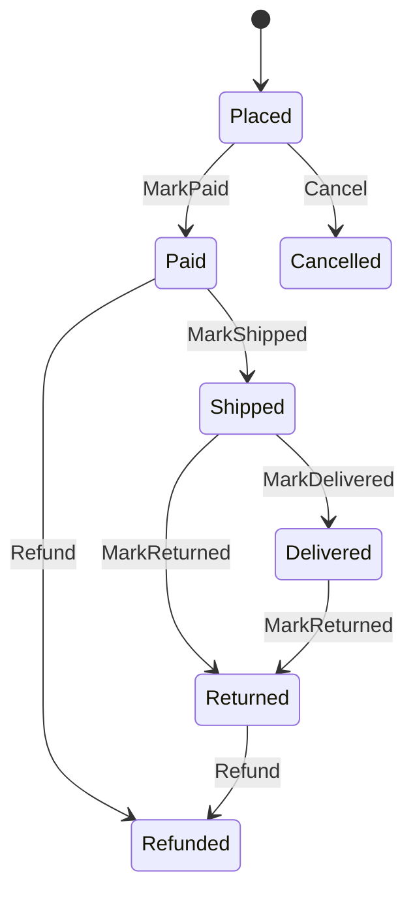

| Status | Accepted |
| -- | -- |
| Date | 2025-09-23 |
| Authors | DemoMike |
| Reviewers | DemoCarol, DemoOscar |
| Specification | [SPEC-047 Order state machine](@SPEC-047) |

## Context

An order's status is changed by four services: `checkout-svc` sets it to placed, `demo-pay` to paid, `fulfilment-svc` to shipped, and support tools to cancelled. Each writes the status column directly. In August, 212 orders ended in impossible states, such as shipped but not paid, because two writers raced.

## Decision

`orders-svc` **owns the order state machine.** Other services ask it to apply a transition; only `orders-svc` writes the status.

* Transitions are named commands (`MarkPaid`, `MarkShipped`, `Cancel`), each with its allowed source states, defined in [SPEC-047](@SPEC-047).
* An illegal transition is rejected with the current state; callers react to the rejection rather than retrying.
* Every accepted transition emits an order event ([SPEC-017](@SPEC-017)) through the outbox ([ADR-014](@ADR-014)).
* Optimistic locking on a `version` column prevents lost updates.

## Options considered

| Option | Impossible states | Writers of the status | Change effort | Verdict |
| -- | -- | -- | -- | -- |
| **State machine in orders-svc** | **0 by construction** | **1** | **one service** | **Chosen** |
| Database constraints and triggers | few | 4 | logic in SQL | Hard to test and to evolve |
| A workflow engine owning orders | 0 | 1 | large | Too heavy for a short state machine; long processes use Temporal ([ADR-040](@ADR-040)) |
| Direct writes (today) | 212 in August | 4 | none | The problem we have |

## Consequences

* Rules about orders live in one place and one test suite.
* The other services lose write access to the orders database ([ADR-015](@ADR-015)).

## Follow-up

- [X] Transition API in `orders-svc`
- [X] `demo-pay` and `fulfilment-svc` call it
- [X] Repair the 212 orders
- [ ] Support tools call it instead of writing SQL
