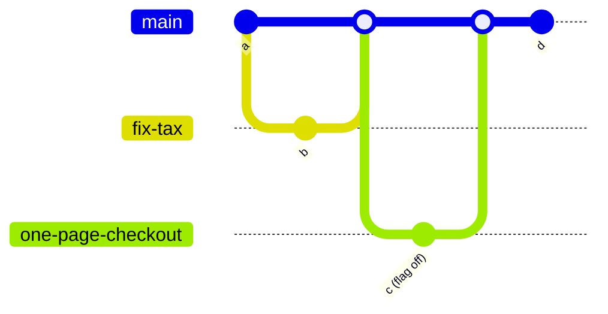

| Status | Accepted |
| -- | -- |
| Date | 2026-02-18 |
| Authors | DemoBob |
| Reviewers | DemoDave, DemoLaura |
| Evidence | [RN-011 Deployment frequency and change failure rate](@RN-011) |

## Context

Teams keep feature branches for weeks and merge them through a `develop` branch into `main` before each fortnightly release. In Q4 2025 the median branch lived 9 days, merge conflicts cost an estimated 6 % of engineering time, and the release branch was frozen for two days before each release. [RN-011](@RN-011) shows a change failure rate of 18 % for changes that sat on a branch longer than a week, against 6 % for shorter ones.

## Decision

We develop on **trunk**: `main` is the only long-lived branch, and every change merges into it within two working days of being started.

* Branches are short: the target is under one day, the limit two days; a weekly report lists older branches.
* Unfinished work merges behind a feature flag ([ADR-022](@ADR-022)).
* `main` is always deployable; every merge to `main` goes through the pipeline of [SPEC-003](@SPEC-003) to production.
* The `develop` branch and release freezes go away; error budgets decide freezes instead ([RFC-009](@RFC-009)).

## Options considered

| Option | Median branch age | Merge conflict cost | Release cadence | Verdict |
| -- | -- | -- | -- | -- |
| **Trunk-based with flags** | **under 1 day (target)** | **low** | **continuous** | **Chosen** |
| GitHub flow with longer branches | 3 to 5 days | medium | continuous | Still long-lived divergence |
| Git flow (today) | 9 days | 6 % of time | every two weeks | The problem we have |

## Consequences

* Smaller changes, more deploys; review becomes a daily habit.
* Feature flags multiply and need cleaning ([ADR-022](@ADR-022)).
* The app keeps its weekly store release ([RFC-072](@RFC-072)), cut from `main`.

## Follow-up

- [X] Delete `develop` in all repositories
- [X] Weekly report of branches older than two days
- [ ] Measure branch age and failure rate again after a quarter
