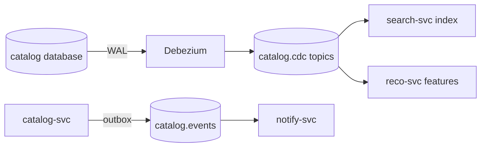

| Status | Implemented |
| -- | -- |
| Date | 2026-04-14 |
| Authors | DemoIvan |
| Reviewers | DemoGrace, DemoCarol |
| Plan | [RFC-017 Change data capture with Debezium](@RFC-017) |
| Evidence | [RN-020 Debezium replication lag](@RN-020) |

## Context

[RFC-017](@RFC-017) replaced the nightly catalog export with a Debezium stream in 2025, first as a trial for search. Since then two more consumers have asked for catalog changes, and the question came up whether they should read the stream or whether `catalog-svc` should publish domain events. This record settles how the search index and similar read models are fed.

## Decision

Read models that mirror catalog tables, starting with the **search index**, are fed from **change data capture** of `catalog-svc`'s database.

* Debezium publishes row changes of `products`, `product_variants`, `prices` and `stock_levels` to `catalog.cdc.*` topics.
* Consumers treat these topics as the catalog's replication stream: they may rebuild state from them but must not infer business meaning, such as "price dropped", from them.
* Business events (`catalog.product.published.v1` and others) still come from `catalog-svc`'s outbox ([ADR-014](@ADR-014)).
* Measured lag at peak is under 2 seconds at p99 ([RN-020](@RN-020)).

## Options considered

| Option | Index freshness | Covers bulk SQL updates | Producer changes | Verdict |
| -- | -- | -- | -- | -- |
| **CDC for read models, events for business facts** | **under 2 s** | **yes** | **none** | **Chosen** |
| Domain events for everything | seconds | no, unless every path emits | many | Bulk updates bypass application code |
| Nightly export | up to 24 h | yes | none | Stale prices in search |

## Consequences

* The search index matches the catalog database row for row; a weekly check compares them.
* Two kinds of catalog topics exist; the topic naming rules ([SPEC-021](@SPEC-021)) keep them apart.

## Follow-up

- [X] `search-svc` on the CDC stream
- [X] Weekly consistency check
- [ ] `reco-svc` features from the CDC stream
