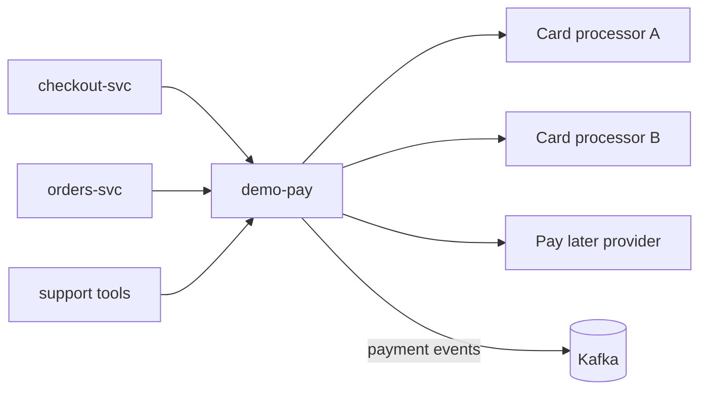

| Status | Accepted |
| -- | -- |
| Date | 2026-05-11 |
| Authors | DemoMike |
| Reviewers | DemoJudy, DemoOscar |
| Specification | [SPEC-048 Payment intents](@SPEC-048) |

## Context

`checkout-svc` talks to two card processors and one buy-now-pay-later provider directly, each through its own client code. Refunds are issued by `orders-svc` and by support tools through yet other paths. Adding a payment method in 2025 took 11 weeks, and reconciling payments with orders needs data from five places ([RFC-025](@RFC-025)).

## Decision

All payments, captures and refunds go through `demo-pay`, **the payment orchestrator**. No other service talks to a payment provider.

* `demo-pay` exposes payment intents ([SPEC-048](@SPEC-048)): create, confirm, capture, cancel and refund, with idempotency on every call.
* Providers sit behind one adapter interface; routing rules pick a provider by method, country and amount.
* 3-D Secure flows ([RFC-049](@RFC-049)) and retries for soft declines ([RFC-050](@RFC-050)) live in `demo-pay` only.
* Every state change emits a payment event ([SPEC-019](@SPEC-019)).



```go
type Provider interface {
    Authorize(ctx context.Context, in AuthorizeInput) (AuthorizeResult, error)
    Capture(ctx context.Context, id string, amount money.Money) error
    Refund(ctx context.Context, id string, amount money.Money, key string) (RefundResult, error)
}
```

## Options considered

| Option | Weeks to add a payment method | Places that hold provider credentials | Reconciliation sources | Verdict |
| -- | -- | -- | -- | -- |
| **One orchestrator in-house** | **3 to 4** | **1** | **1** | **Chosen** |
| A third-party payment orchestration service | 1 to 2 | 1 (vendor) | 1 | 0.4 % extra fee on volume |
| Direct integrations (today) | 11 | 4 | 5 | The problem we have |

## Consequences

* `demo-pay` becomes critical for checkout; it gets the strictest SLO ([ADR-033](@ADR-033)) and runs in both regions ([ADR-048](@ADR-048)).
* Provider outages can be handled by routing to another provider.

## Follow-up

- [X] Adapters for both card processors
- [ ] Pay later provider adapter
- [ ] Refunds from support tools through `demo-pay`
