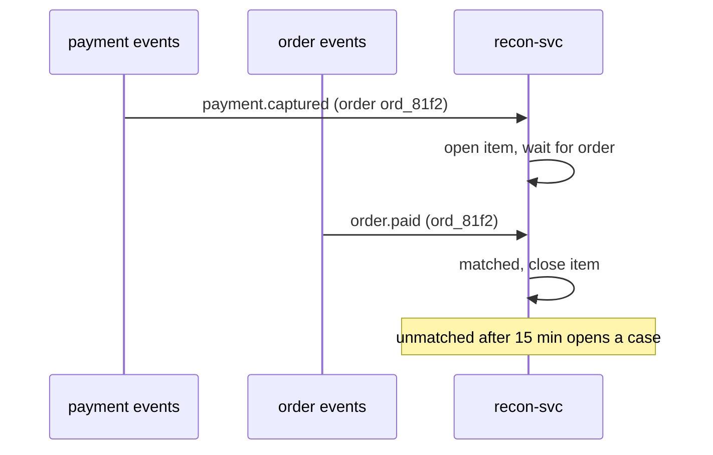

| Status | Accepted |
| -- | -- |
| Date | 2026-10-06 |
| Authors | DemoMike |
| Reviewers | DemoCarol, DemoIvan |
| Supersedes | [ADR-029 Run batch jobs as Kubernetes CronJobs](@ADR-029) |
| Plan | [RFC-025 Streaming reconciliation of payments and orders](@RFC-025) |

## Context

Payment reconciliation runs nightly as a CronJob ([ADR-029](@ADR-029)): it compares the day's orders with the settlement files of the payment providers. It takes 70 to 140 minutes, fails when its spot node is interrupted, and finds a mismatch up to 24 hours after it happens. In September a captured but unconfirmed payment left 61 buyers charged without an order until the next morning.

## Decision

Reconciliation becomes a **streaming consumer**: `recon-svc` matches payment events with order events as they arrive and flags mismatches within minutes.

* It consumes payment events ([SPEC-019](@SPEC-019)) and order events ([SPEC-017](@SPEC-017)) and keeps open items in its own PostgreSQL database.
* An item that is not matched within 15 minutes raises a case; captured payments without an order are refunded automatically after 2 hours unless matched.
* Provider settlement files are still compared daily, as a second check, in a small Temporal scheduled workflow ([ADR-040](@ADR-040)).
* The remaining CronJobs move to Temporal schedules too, so this record supersedes ADR-029 as a whole.

## Options considered

| Option | Time to detect a mismatch | Fails on node interruption | Verdict |
| -- | -- | -- | -- |
| **Streaming reconciliation** | **15 min** | **no, resumes from offsets** | **Chosen** |
| Run the batch every hour | up to 1 h | yes | Same fragility, more often |
| Nightly CronJob (today) | up to 24 h | yes | The problem we have |

## Consequences

* Buyers charged without an order are refunded within hours, not days.
* `recon-svc` is a new service owned by the payments team.

## Follow-up

- [X] `recon-svc` in shadow mode next to the nightly job
- [ ] Automatic refunds for unmatched captures
- [ ] Remove the nightly job and the other CronJobs
