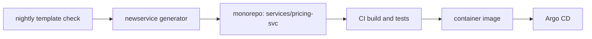

| Status | Implemented |
| -- | -- |
| Created | 2025-02-11 |
| Authors | DemoFrank |
| Reviewers | DemoAlice, DemoGrace |
| Target | Q2 2025 |
| Decision | [ADR-003 Use Go for backend services](@ADR-003) |

## Summary

Start every Go service from one template that already has health endpoints, structured logging, tracing, metrics, graceful shutdown and a Dockerfile, instead of copying the nearest existing service.

## Motivation

After [ADR-003](@ADR-003), four new services were written in six weeks. Each copied a different predecessor. A review in February 2025 found five ways of reading configuration, three log formats and two services without readiness checks. Setting up a new service took a median of 4 days before its first business endpoint.

## Proposal

A template directory in the monorepo ([ADR-030](@ADR-030)), applied with a generator:

```sh
go run ./tools/newservice --name pricing-svc --owner checkout --port 8080
```

The generated service contains:

| Part | What it gives | Follows |
| -- | -- | -- |
| `cmd/server/main.go` | Start, signal handling, shutdown in order | [RFC-010](@RFC-010) |
| `internal/health` | `/livez` and `/readyz` | [SPEC-002](@SPEC-002) |
| `internal/telemetry` | OpenTelemetry traces and metrics | [SPEC-005](@SPEC-005), [SPEC-006](@SPEC-006) |
| `internal/logging` | JSON logs with trace ids | [SPEC-004](@SPEC-004) |
| `internal/config` | Typed configuration from the environment | [RFC-012](@RFC-012) |
| `deploy/` | Service manifest and Kubernetes objects | [SPEC-001](@SPEC-001) |
| `Dockerfile` | Distroless image, non-root user | [RFC-013](@RFC-013) |

The template is code, not documentation: a nightly job generates a service from it, builds it and runs its tests, so the template cannot rot.



### Keeping existing services in line

Template changes that every service needs (a new log field, a dependency bump) are applied with a codemod across services in one pull request.

## Alternatives

| Option | Consistency | Upkeep | Why not |
| -- | -- | -- | -- |
| Copy an existing service (today) | low | none | The problem we have |
| A shared framework library | high | high, every service upgrades it | Hides `main`, hard to debug |
| **Template plus codemods** | **high** | **medium** | Chosen |

## Rollout

- [X] Template with health, logging, telemetry and shutdown
- [X] Generator and nightly check
- [X] `pricing-svc` and `reco-svc` generated from it
- [X] Codemod moves eight older services to the template's logging and health code

## Open questions

* Should the template include a gRPC server by default? Today it is a flag, because three of twelve services have no gRPC API ([ADR-006](@ADR-006)).
