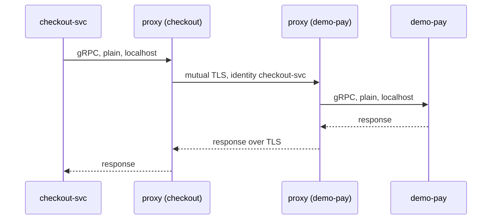

| Status | Rejected |
| -- | -- |
| Created | 2025-05-20 |
| Authors | DemoFrank |
| Reviewers | DemoAlice, DemoErin, DemoKen |
| Target | Q3 2025 |
| Evidence | [RN-004 Service mesh latency overhead](@RN-004) |

## Summary

Run a sidecar service mesh to encrypt and authenticate all traffic between services with mutual TLS. **Rejected** in July 2025: the latency and memory cost was too high for what we gain over the alternative we chose.

## Motivation

Traffic between services inside the cluster is plain gRPC ([ADR-006](@ADR-006)). Network policies limit which pods may talk to each other, but a compromised pod can read any traffic on its node, and services cannot prove to each other who is calling. The payments review in April 2025 asked for encryption in transit everywhere `demo-pay` data flows.

## Proposal

Install a sidecar mesh in every namespace. Each pod gets a proxy that terminates and originates mutual TLS with certificates issued by the mesh and rotated every 24 hours. Services stay unchanged.



Authorisation policies would replace network policies:

```yaml
apiVersion: security.istio.io/v1
kind: AuthorizationPolicy
metadata:
  name: demo-pay-callers
  namespace: payments
spec:
  selector:
    matchLabels:
      app: demo-pay
  rules:
    - from:
        - source:
            principals: ["cluster.local/ns/checkout/sa/checkout-svc"]
```

## Why it was rejected

[RN-004](@RN-004) measured the mesh on a copy of the checkout path. Each hop added 1.8 ms at p50 and 6.4 ms at p99; checkout makes 7 internal calls in sequence, so p99 grew by 31 ms. Every pod needed about 60 MiB more memory, 14 % more memory across the cluster.

## Alternatives

| Option | Encryption | Service identity | Cost | Outcome |
| -- | -- | -- | -- | -- |
| Sidecar mesh | yes | yes | 31 ms p99 on checkout, 14 % memory | Rejected |
| Sidecar-less mesh (node proxies) | yes | yes | lower, not yet stable for us | Revisit in 2026 |
| **TLS in the gRPC clients, certificates from the platform** | **yes** | **yes, by certificate name** | **under 1 ms** | **Chosen instead** |
| Network policies only (today) | no | no | none | Not enough for payments |

## Rollout

- [X] Mesh measured in staging ([RN-004](@RN-004))
- [X] Decision to reject recorded
- [X] gRPC client TLS added to the service template ([RFC-002](@RFC-002))
- [X] `demo-pay` and its callers use mutual TLS in the client

## Open questions

* Revisit node-proxy meshes when they reach a stable release supported by our cloud provider.
