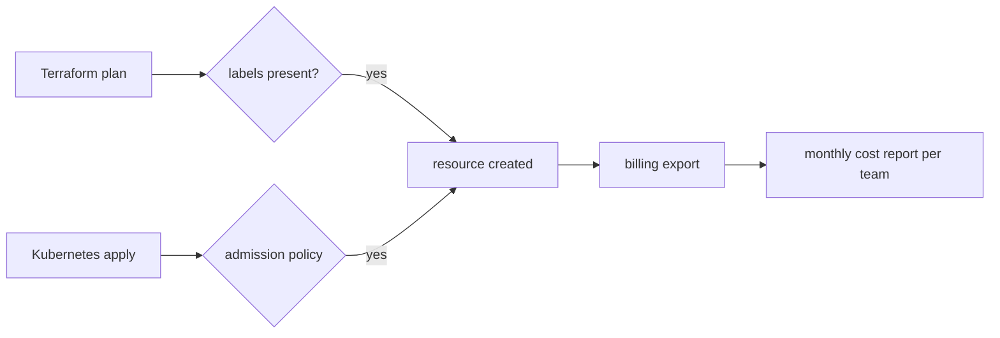

| Status | Implemented |
| -- | -- |
| Created | 2025-08-12 |
| Authors | DemoNina |
| Reviewers | DemoErin, DemoKen |
| Target | Q4 2025 |
| Specification | [SPEC-014 Cost allocation labels](@SPEC-014) |

## Summary

Every Kubernetes workload and every cloud resource carries four labels (team, service, environment, cost centre), so the monthly cloud bill can be split by team and service.

## Motivation

The cloud bill was 186,000 USD in July 2025. 41 % of it could not be assigned to a team: shared node pools, unlabelled volumes and load balancers created by hand. Without a split, no team can see what its service costs, and nobody owns the growth of 6 % a month.

## Proposal

### Labels

| Label | Example | Required on |
| -- | -- | -- |
| `demomart.example.com/team` | `checkout` | everything |
| `demomart.example.com/service` | `cart-svc` | workloads, volumes, databases |
| `demomart.example.com/env` | `production` | everything |
| `demomart.example.com/cost-centre` | `cc-210` | everything |

The full rules are in [SPEC-014](@SPEC-014).

### Enforcement

* Kubernetes: an admission policy rejects workloads without the labels in production and warns in staging.
* Terraform ([ADR-009](@ADR-009)): a `default_tags` block per provider and a CI check that fails a plan with untagged resources.
* Shared node pools: cost is split by each pod's requested CPU and memory, measured hourly.

```yaml
apiVersion: kyverno.io/v1
kind: ClusterPolicy
metadata:
  name: require-cost-labels
spec:
  validationFailureAction: Enforce
  rules:
    - name: cost-labels
      match:
        any:
          - resources:
              kinds: [Deployment, StatefulSet, CronJob]
      validate:
        message: "team, service, env and cost-centre labels are required"
        pattern:
          metadata:
            labels:
              demomart.example.com/team: "?*"
              demomart.example.com/service: "?*"
              demomart.example.com/env: "?*"
              demomart.example.com/cost-centre: "?*"
```



## Alternatives

| Option | Share of the bill assigned | Why not |
| -- | -- | -- |
| One cloud account per team | about 95 % | Large migration, shared clusters impossible |
| Tag only what is easy | about 75 % | Leaves the shared pools unassigned |
| **Labels everywhere, split shared pools by requests** | **about 96 %** | Chosen |

## Rollout

- [X] Labels added to all Terraform modules
- [X] Admission policy in warn mode, then enforce
- [X] Hand-made load balancers imported into Terraform
- [X] First monthly report per team (November 2025: 96 % assigned)
- [X] Cost per request per service ([RN-008](@RN-008))

## Open questions

* Network egress is billed per account, not per resource; it is split by bytes sent per service from flow logs, which is an estimate.
