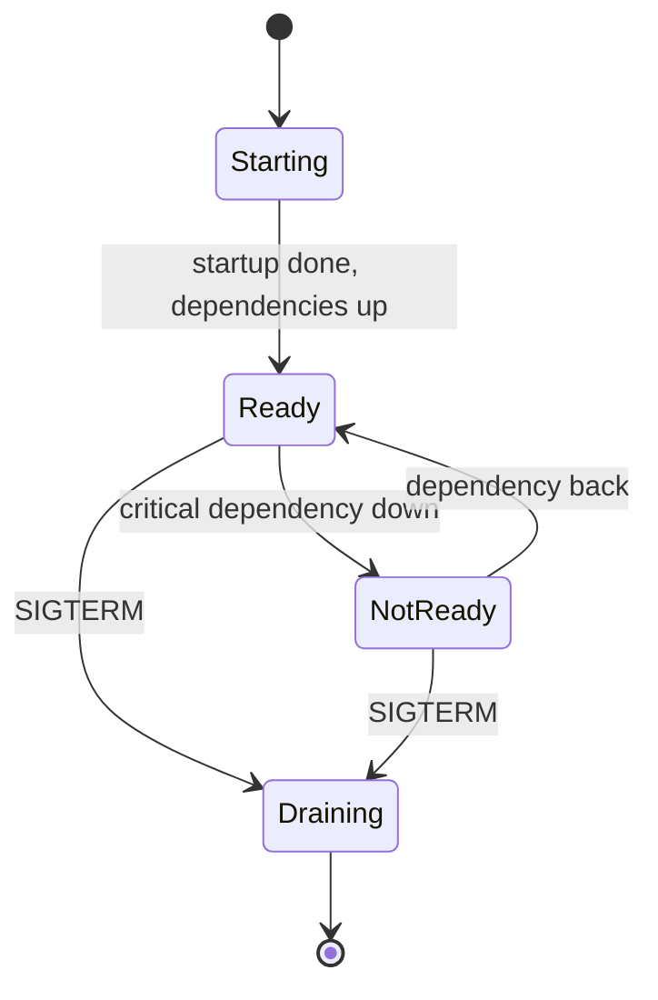

| Status | Implemented |
| -- | -- |
| Created | 2025-03-04 |
| Authors | DemoErin |
| Reviewers | DemoFrank, DemoGrace |
| Target | Q2 2025 |
| Specification | [SPEC-002 Health check endpoints](@SPEC-002) |

## Summary

Every service exposes `/livez` and `/readyz` with the same meaning and format, and Kubernetes probes use them with the same timings.

## Motivation

In March 2025, services answered health checks in six ways. Two services reported "ready" before their database pool was open, so new pods took traffic and failed it for up to 20 seconds after each deploy. One service checked its database in the liveness probe; when the database was slow, Kubernetes restarted all its pods at once and turned a slow database into an outage.

## Proposal

### Two endpoints, two meanings

| Endpoint | Question it answers | Checks | On failure |
| -- | -- | -- | -- |
| `/livez` | Is the process able to work at all? | event loop or goroutine scheduler responds, no deadlock | Kubernetes restarts the pod |
| `/readyz` | Should this pod get traffic now? | own dependencies it cannot work without, startup finished, not shutting down | Pod is taken out of the load balancer |

A dependency check never goes into `/livez`. The response format and per-check details are in [SPEC-002](@SPEC-002).

```go
health.Register(health.Check{
    Name:     "postgres",
    Critical: true,
    Timeout:  500 * time.Millisecond,
    Run: func(ctx context.Context) error {
        return pool.Ping(ctx)
    },
})
```

### Probe timings

```yaml
livenessProbe:
  httpGet: { path: /livez, port: 8080 }
  periodSeconds: 10
  failureThreshold: 3
readinessProbe:
  httpGet: { path: /readyz, port: 8080 }
  periodSeconds: 5
  failureThreshold: 2
startupProbe:
  httpGet: { path: /livez, port: 8080 }
  periodSeconds: 2
  failureThreshold: 60
```



## Alternatives

| Option | Why not |
| -- | -- |
| One `/health` endpoint for both probes | Mixes "restart me" with "skip me"; caused the restart storm |
| Probes on TCP port only | Says nothing about readiness |
| **Two endpoints with fixed meanings** | Chosen |

## Rollout

- [X] Health package in the service template ([RFC-002](@RFC-002))
- [X] All twelve services on the new endpoints
- [X] Probe timings applied through the service manifest ([SPEC-001](@SPEC-001))
- [X] Alert when a pod is not ready for more than 5 minutes

## Open questions

* None left; the draining state is covered by [RFC-010](@RFC-010).
