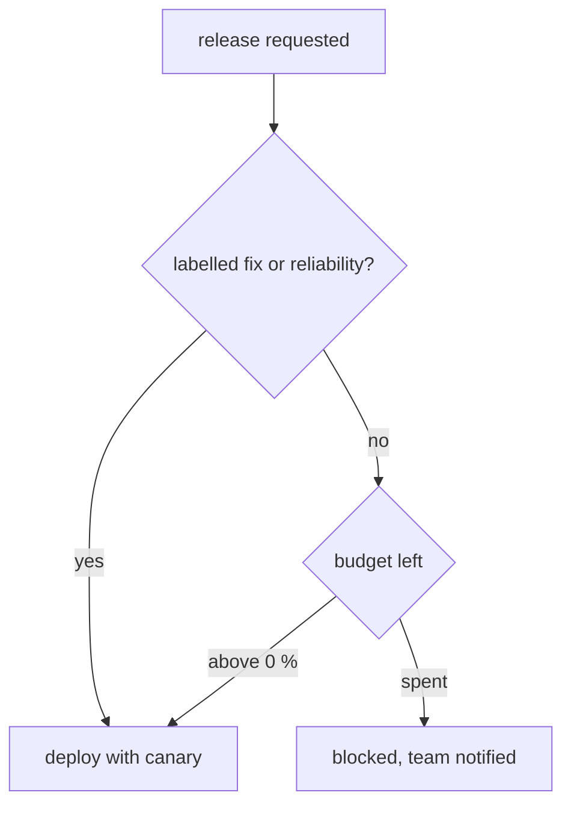

| Status | Accepted |
| -- | -- |
| Created | 2026-01-27 |
| Authors | DemoKen |
| Reviewers | DemoAlice, DemoErin, DemoLaura |
| Target | Q2 2026 |
| Decision | [ADR-033 Set service level objectives for customer-facing services](@ADR-033) |

## Summary

Turn each service level objective into an error budget for 28 days, and when a service has spent its budget, pause its feature releases until the budget recovers. Fixes and reliability work still ship.

## Motivation

[ADR-033](@ADR-033) gave every customer-facing service objectives, but nothing happens when a service misses them. In Q4 2025, `search-svc` missed its availability objective in two of three months while shipping 41 releases, 6 of which caused the misses. Reliability work kept losing to features in planning because nobody could say how much unreliability was too much.

## Proposal

### Budgets

The budget is the share of requests allowed to fail over a rolling 28-day window. For an objective of 99.9 % successful requests, the budget is 0.1 % of all requests in the window. Objectives are defined in [SPEC-008](@SPEC-008).

| Service | Objective | Budget over 28 days at today's traffic |
| -- | -- | -- |
| `checkout-svc` | 99.95 % | about 4,200 failed requests |
| `cart-svc` | 99.9 % | about 31,000 failed requests |
| `search-svc` | 99.9 % | about 96,000 failed requests |
| `catalog-svc` | 99.9 % | about 58,000 failed requests |

### Policy

| Budget left | What happens |
| -- | -- |
| more than 50 % | Normal releases |
| 25 % to 50 % | Releases continue; the service's team reviews the main causes at its weekly meeting |
| 0 % to 25 % | Only releases that a reviewer marks as low risk |
| spent | Feature releases stop; fixes and reliability work only, until the budget is above 10 % again |

A freeze is enforced in the delivery pipeline: the deploy stage ([SPEC-003](@SPEC-003)) checks the budget and refuses a release that is not labelled `fix` or `reliability`.



### Burn rate alerts

Alerts fire on burn rate, not on single errors: a page when a service burns 2 % of its budget in one hour, a ticket when it burns 10 % in three days ([SPEC-007](@SPEC-007)).

```yaml
- alert: CheckoutFastBurn
  expr: |
    (1 - slo:checkout_success:ratio_rate1h) > (14.4 * 0.0005)
  for: 5m
  labels:
    severity: page
```

## Alternatives

| Option | Why not |
| -- | -- |
| Objectives without consequences (today) | Misses do not change plans |
| A freeze for all services when one misses | Punishes teams for others' problems |
| **Per-service budgets with a release gate** | Chosen |

## Rollout

- [X] Budgets computed for all objectives
- [X] Burn rate alerts replace threshold alerts
- [ ] Release gate in the pipeline, warn only for one month
- [ ] Release gate enforced

## Open questions

* Should a failure caused by another service spend the caller's budget? Proposed: yes for now, since buyers see it either way; revisit after three months of data.
