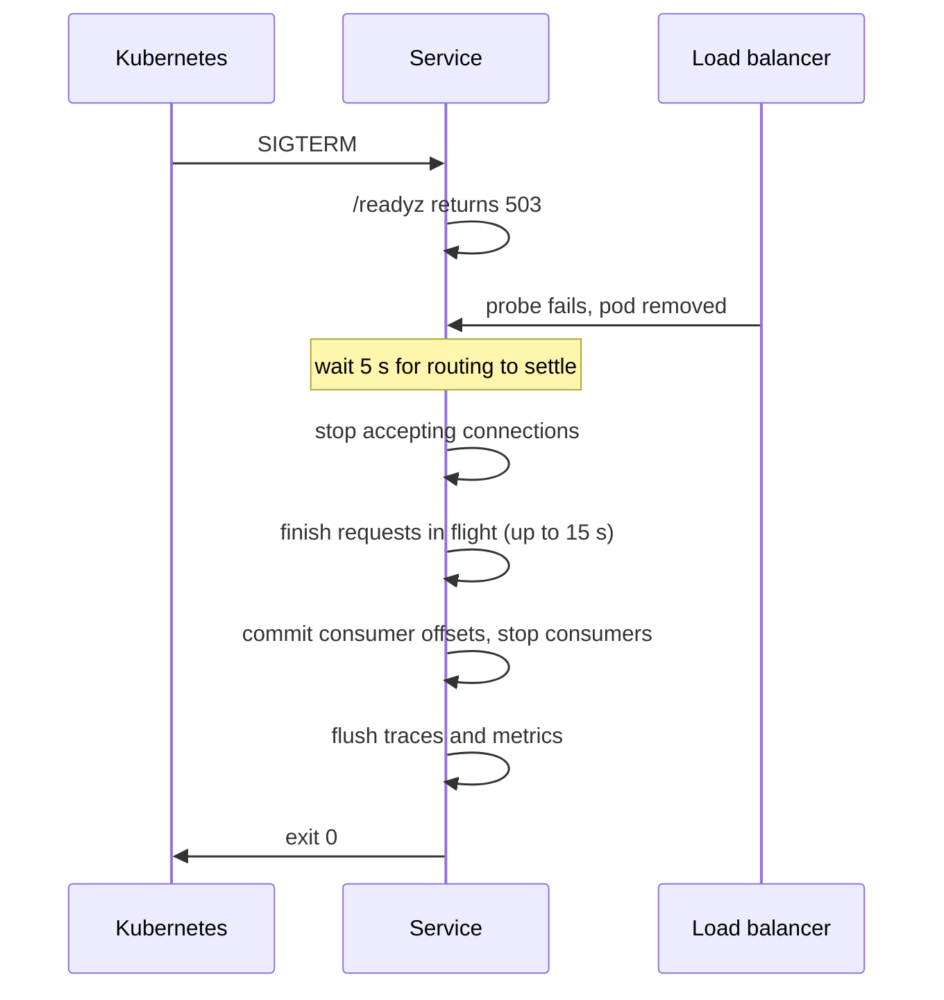

| Status | Implemented |
| -- | -- |
| Created | 2025-04-15 |
| Authors | DemoGrace |
| Reviewers | DemoErin, DemoFrank |
| Target | Q2 2025 |
| Evidence | [RN-013 Graceful shutdown and dropped requests](@RN-013) |

## Summary

Every service handles SIGTERM the same way: it stops being ready, waits for the load balancer to notice, finishes requests in flight, stops consumers, flushes telemetry and exits, all within 30 seconds.

## Motivation

Each deploy of `cart-svc` dropped between 40 and 120 requests with connection errors in March 2025. Pods exited on SIGTERM immediately, while the load balancer kept sending them traffic for several seconds. Kafka consumers stopped mid-batch and reprocessed up to 500 events after a restart. [RN-013](@RN-013) measured the effect across services.

## Proposal

### Order of shutdown



### Timings

| Phase | Time limit |
| -- | -- |
| Not ready, wait for routing | 5 s |
| Finish requests in flight | 15 s |
| Stop consumers and commit offsets | 5 s |
| Flush telemetry | 3 s |
| Kubernetes `terminationGracePeriodSeconds` | 30 s |

The code is part of the service template ([RFC-002](@RFC-002)):

```go
func run(ctx context.Context, srv *http.Server, consumers *kafka.Group, tel *telemetry.Provider) error {
    <-ctx.Done()
    health.SetDraining()
    time.Sleep(5 * time.Second)

    shutdownCtx, cancel := context.WithTimeout(context.Background(), 15*time.Second)
    defer cancel()
    if err := srv.Shutdown(shutdownCtx); err != nil {
        log.Warn("requests still running at shutdown", "error", err)
    }
    consumers.Close(5 * time.Second)
    return tel.Flush(3 * time.Second)
}
```

## Alternatives

| Option | Why not |
| -- | -- |
| A `preStop` sleep hook only | Covers routing, not consumers or telemetry |
| Longer grace period, no ordering | Requests still fail in the first seconds |
| **Ordered shutdown in the template** | Chosen |

## Rollout

- [X] Shutdown sequence in the service template
- [X] `cart-svc` and `checkout-svc` first; dropped requests per deploy measured
- [X] All services moved
- [X] Deploy dashboards show dropped requests per rollout

## Open questions

* Long-running streaming responses (order exports) can take longer than 15 seconds. They now resume from a cursor on the client side ([SPEC-033](@SPEC-033)).
