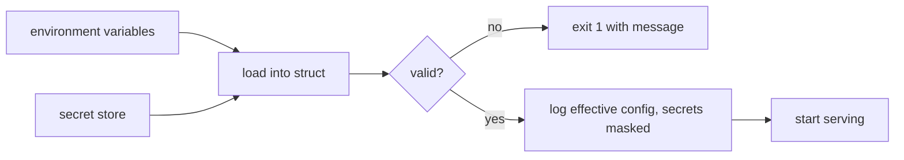

| Status | Accepted |
| -- | -- |
| Created | 2025-07-08 |
| Authors | DemoFrank |
| Reviewers | DemoGrace, DemoKen |
| Target | Q3 2025 |
| Related | [ADR-047 Keep secrets in a managed secret store](@ADR-047) |

## Summary

Each service declares its configuration as one typed struct with defaults and validation. It is read from environment variables at startup, and a service with invalid configuration refuses to start, with a message naming the variable.

## Motivation

In the first half of 2025, 7 of 23 failed deploys were caused by configuration: a missing variable that defaulted to an empty string, a timeout given as `30` where the code expected `30s`, a feature switch spelled differently in two environments. Each was found only when a request hit the broken path.

## Proposal

### One struct per service

```go
type Config struct {
    HTTPPort        int           `env:"HTTP_PORT" default:"8080"`
    DatabaseURL     string        `env:"DATABASE_URL" required:"true" secret:"true"`
    RequestTimeout  time.Duration `env:"REQUEST_TIMEOUT" default:"2s" min:"100ms" max:"30s"`
    KafkaBrokers    []string      `env:"KAFKA_BROKERS" required:"true"`
    MaxCartItems    int           `env:"MAX_CART_ITEMS" default:"100" min:"1" max:"500"`
}
```

### Rules

| Rule | Behaviour |
| -- | -- |
| Required and missing | Startup fails, naming the variable |
| Wrong type or unit | Startup fails: `REQUEST_TIMEOUT: "30" is not a duration, use 30s` |
| Out of range | Startup fails with the allowed range |
| Unknown variable with the service's prefix | Warning in the log, to catch typos |
| Secret | Value never logged; read from the secret store ([SPEC-010](@SPEC-010)) |

At startup the service logs its effective configuration with secrets masked, so an engineer can see what a pod actually runs with.



### Documentation from code

A CI step generates a table of each service's variables from the struct and publishes it next to the service manifest ([SPEC-001](@SPEC-001)).

## Alternatives

| Option | Why not |
| -- | -- |
| A central configuration service | A new runtime dependency for every startup |
| Configuration files per environment | Secrets and values mixed; drift between files |
| **Typed struct from the environment** | Chosen; already how Kubernetes passes values |

## Rollout

- [X] Configuration package in the service template ([RFC-002](@RFC-002))
- [ ] Remaining services moved, one pull request each
- [ ] CI step that generates the variables table

## Open questions

* Some values change at runtime (rate limits, feature switches). Those stay in the feature flag service ([SPEC-009](@SPEC-009)), not in configuration.
