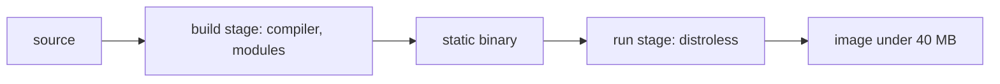

| Status | Implemented |
| -- | -- |
| Created | 2025-10-14 |
| Authors | DemoMike |
| Reviewers | DemoFrank, DemoNina |
| Target | Q4 2025 |
| Evidence | [RN-006 Container image sizes across services](@RN-006) |

## Summary

Build every service image in two stages and ship it on a distroless base, with no shell or package manager. Target: Go services under 40 MB, Node.js services under 180 MB.

## Motivation

[RN-006](@RN-006) found a median image size of 412 MB across services. Large images slow every scale-out: pulling a 900 MB image onto a fresh node took 38 seconds, which is most of the time a new pod needs before it is ready. Images based on full operating systems also carried 140 known vulnerabilities on average, almost all in packages the services never use.

## Proposal

### Base images

| Runtime | Build stage | Run stage |
| -- | -- | -- |
| Go | `golang:1.25` | `gcr.io/distroless/static-debian12:nonroot` |
| Node.js (web shop) | `node:24` | `gcr.io/distroless/nodejs24-debian12:nonroot` |
| JVM (none left after [ADR-003](@ADR-003)) | | |

```dockerfile
FROM golang:1.25 AS build
WORKDIR /src
COPY go.mod go.sum ./
RUN go mod download
COPY . .
RUN CGO_ENABLED=0 go build -trimpath -ldflags="-s -w" -o /out/server ./cmd/server

FROM gcr.io/distroless/static-debian12:nonroot
COPY --from=build /out/server /server
USER nonroot:nonroot
ENTRYPOINT ["/server"]
```

### Debugging without a shell

With no shell in the image, engineers attach an ephemeral debug container when they need tools:

```sh
kubectl debug -it cart-svc-7f9c6d-x2k4q --image=busybox:1.37 --target=server
```



## Alternatives

| Option | Typical Go image | Why not |
| -- | -- | -- |
| Full OS base (today) | 380 MB | Size and vulnerabilities |
| Alpine base | 25 MB | musl differences broke DNS behaviour in one service |
| `scratch` base | 18 MB | No CA certificates or time zone data without extra steps |
| **Distroless static** | **22 MB** | Chosen |

## Rollout

- [X] Template Dockerfile changed ([RFC-002](@RFC-002))
- [X] All Go services rebuilt
- [X] Web shop on the distroless Node.js image
- [X] CI fails a build whose image grows more than 20 % in one change

## Open questions

* None. Image labels for ownership and source are covered by [SPEC-011](@SPEC-011).
