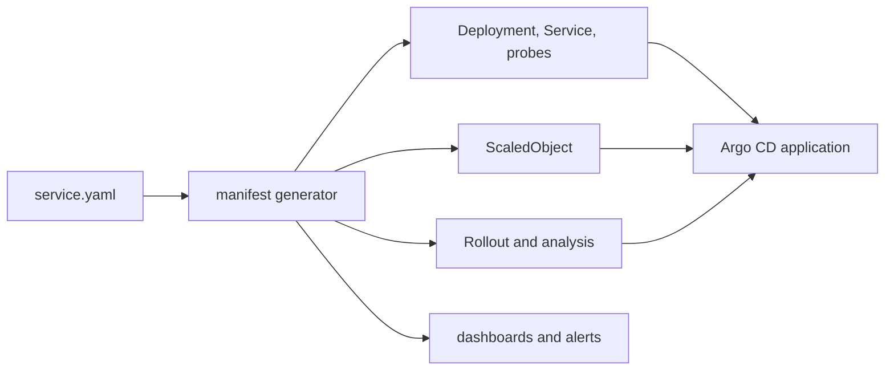

| Status | Stable |
| -- | -- |
| Version | 2.1 |
| Updated | 2026-04-07 |
| Owner | DemoErin |
| Applies to | Every service deployed to Kubernetes |

## Overview

A service manifest is one YAML file, `deploy/service.yaml`, that describes a service in terms the platform understands: who owns it, how it runs, how it scales and what it depends on. A generator turns it into Kubernetes objects, Argo CD applications ([ADR-008](@ADR-008)), dashboards and alerts. Teams edit the manifest, never the generated objects.

## Fields

| Field | Type | Required | Default | Description |
| -- | -- | -- | -- | -- |
| `name` | string | yes | | Service name, ends in `-svc`, unique |
| `team` | string | yes | | Owning team; also the cost label ([SPEC-014](@SPEC-014)) |
| `tier` | `critical`, `standard`, `internal` | yes | | Sets defaults for replicas, alerts and objectives |
| `ports.http` | int | no | 8080 | HTTP port for API and health |
| `ports.grpc` | int | no | | gRPC port, if any |
| `resources.cpu` | string | yes | | CPU request, for example `500m` |
| `resources.memory` | string | yes | | Memory request and limit |
| `scaling.min` / `scaling.max` | int | no | by tier | Replica bounds |
| `scaling.requestsPerPod` | int | no | | Enables request-rate autoscaling ([RFC-003](@RFC-003)) |
| `release.strategy` | `canary`, `rolling` | no | `canary` for critical | [RFC-001](@RFC-001) |
| `dependencies` | list | no | | Databases, topics and services it calls |
| `slo.availability` | percent | no | by tier | [SPEC-008](@SPEC-008) |

### Defaults by tier

| Tier | Minimum replicas | Release | Availability objective | Paging |
| -- | -- | -- | -- | -- |
| `critical` | 3 | canary | 99.95 % | yes |
| `standard` | 2 | canary | 99.9 % | working hours |
| `internal` | 1 | rolling | 99.5 % | no |

## Example

```yaml
name: cart-svc
team: checkout
tier: critical
ports:
  http: 8080
  grpc: 9090
resources:
  cpu: 500m
  memory: 512Mi
scaling:
  min: 4
  max: 40
  requestsPerPod: 400
release:
  strategy: canary
dependencies:
  databases: [cart]
  caches: [redis-cart]
  topics:
    produces: [cart.events]
  services: [catalog-svc, identity-svc]
slo:
  availability: 99.95
```

## Generation



## Validation errors

| Code | Example | Meaning |
| -- | -- | -- |
| `M001` | `name: Cart` | Name must be lowercase and end in `-svc` |
| `M002` | `tier: high` | Unknown tier |
| `M003` | `scaling.min: 0` on `critical` | Critical services need at least 3 replicas |
| `M004` | dependency `topics: [cart]` | Topic name does not follow [SPEC-021](@SPEC-021) |
| `M005` | missing `resources.memory` | Memory request is required |

## Version history

| Version | Date | Change |
| -- | -- | -- |
| 1.0 | 2025-03-18 | First version |
| 1.1 | 2025-05-06 | Health probes taken from [SPEC-002](@SPEC-002) |
| 2.0 | 2025-11-25 | Canary release strategy; tiers replace free-form replica counts |
| 2.1 | 2026-04-07 | `scaling.requestsPerPod` |

## Related

* [RFC-002 A shared service template for Go services](@RFC-002)
* [SPEC-003 Deployment pipeline stages](@SPEC-003)
