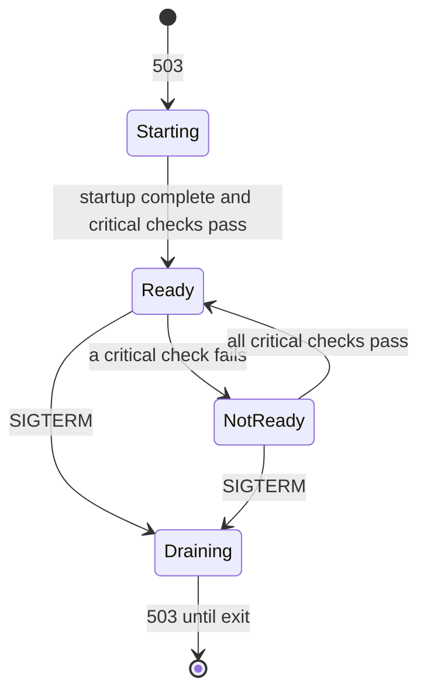

| Status | Stable |
| -- | -- |
| Version | 1.2 |
| Updated | 2025-09-16 |
| Owner | DemoErin |
| Applies to | Every HTTP or gRPC service |

## Overview

Every service answers two endpoints on its HTTP port: `/livez` says whether the process works, `/readyz` says whether it should get traffic. The reasons for the split are in [RFC-008](@RFC-008).

## Endpoints

| Endpoint | Success | Failure | Checks | Response time limit |
| -- | -- | -- | -- | -- |
| `GET /livez` | `200` | `503` | internal only: scheduler, deadlock detector | 100 ms |
| `GET /readyz` | `200` | `503` | startup done, not draining, critical dependencies | 1 s |
| `GET /readyz?verbose=1` | `200` or `503` | | as above, with each check's result | 1 s |

Neither endpoint requires authentication. Both are served only on the internal port and never through the gateway.

## Response

A verbose response lists each check:

```json
{
  "status": "fail",
  "service": "cart-svc",
  "version": "2026.09.14-3",
  "checks": [
    { "name": "postgres", "critical": true, "status": "pass", "durationMs": 3 },
    { "name": "redis-cart", "critical": true, "status": "fail", "durationMs": 500, "error": "timeout after 500ms" },
    { "name": "catalog-svc", "critical": false, "status": "pass", "durationMs": 12 }
  ]
}
```

| Field | Type | Description |
| -- | -- | -- |
| `status` | `pass` or `fail` | `fail` if any critical check fails, or the service is starting or draining |
| `service` | string | Service name from the manifest ([SPEC-001](@SPEC-001)) |
| `version` | string | Image version ([SPEC-011](@SPEC-011)) |
| `checks[].critical` | boolean | Only critical checks change `status` |
| `checks[].durationMs` | integer | Time the check took |

## Rules for checks

* A check has a timeout of at most 500 ms; results are cached for 2 seconds so probes never pile up.
* Only dependencies the service cannot work without are critical. A service that can serve from cache when the catalogue is down marks `catalog-svc` as non-critical.
* A check never calls another service's `/readyz`; it calls a cheap operation of its own client.



## Probe settings

| Probe | Path | Period | Failures before action |
| -- | -- | -- | -- |
| Startup | `/livez` | 2 s | 60 |
| Liveness | `/livez` | 10 s | 3 |
| Readiness | `/readyz` | 5 s | 2 |

## Version history

| Version | Date | Change |
| -- | -- | -- |
| 1.0 | 2025-03-25 | First version |
| 1.1 | 2025-05-13 | Draining state ([RFC-010](@RFC-010)) |
| 1.2 | 2025-09-16 | `version` field; check results cached for 2 s |

## Related

* [RFC-008 Standard health and readiness endpoints](@RFC-008)
* [RFC-010 Graceful shutdown for all services](@RFC-010)
