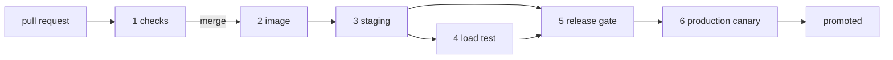

| Status | Stable |
| -- | -- |
| Version | 3.0 |
| Updated | 2026-05-19 |
| Owner | DemoMike |
| Applies to | Every service in the monorepo |

## Overview

Every change to a service goes through the same stages from pull request to production. Stages are defined once and reused; a service's pipeline only sets its name and paths. Deploys happen by commits to the environments repository, which Argo CD applies ([ADR-008](@ADR-008)).

## Stages

| Stage | Runs on | Must pass to continue | Typical time |
| -- | -- | -- | -- |
| 1. Checks | every push | lint, unit tests, build | 4 min |
| 2. Image | merge to `main` | image built, scanned, signed | 3 min |
| 3. Staging | after image | deploy to staging, smoke tests | 6 min |
| 4. Load test | after staging, critical tier only | p99 and error rate within budget ([ADR-046](@ADR-046)) | 10 min |
| 5. Release gate | after staging | error budget not spent ([RFC-009](@RFC-009)) | instant |
| 6. Production | after the gate | canary steps pass ([RFC-001](@RFC-001)) | 35 min |



## Pipeline definition

```yaml
service: cart-svc
paths:
  - services/cart-svc/**
  - libs/money/**
stages:
  load_test:
    scenario: cart-browse-and-add
    duration: 10m
    max_p99_ms: 250
    max_error_rate: 0.001
```

## Image scanning

| Finding | Effect |
| -- | -- |
| Critical vulnerability with a fix available | Stage 2 fails |
| High vulnerability with a fix available | Warning; fails after 14 days |
| Vulnerability without a fix | Recorded in the service catalogue |
| Unsigned image | Production refuses it |

## Labels that change the pipeline

| Label on the pull request | Effect |
| -- | -- |
| `fix` | Passes the release gate during a freeze |
| `reliability` | Passes the release gate during a freeze |
| `skip-load-test` | Allowed only for documentation-only changes; checked by paths |

## Version history

| Version | Date | Change |
| -- | -- | -- |
| 1.0 | 2025-04-29 | Checks, image, staging, production |
| 2.0 | 2025-11-25 | Canary production stage |
| 2.1 | 2026-02-10 | Image signing |
| 3.0 | 2026-05-19 | Load test and release gate stages |

## Related

* [SPEC-001 Service manifest format](@SPEC-001)
* [RN-011 Deployment frequency and change failure rate](@RN-011)
* [ADR-032 Adopt trunk-based development](@ADR-032)
