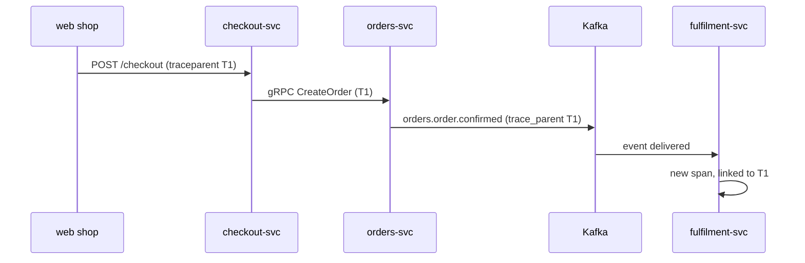

| Status | Stable |
| -- | -- |
| Version | 1.1 |
| Updated | 2026-01-20 |
| Owner | DemoGrace |
| Applies to | HTTP, gRPC and Kafka traffic of every service |

## Overview

A trace follows one buyer action through every service it touches. Services pass the trace context on every outgoing call and every published event, using W3C Trace Context, and record spans with OpenTelemetry ([ADR-010](@ADR-010)).

## Carriers

| Transport | Where the context travels | Fields |
| -- | -- | -- |
| HTTP | headers | `traceparent`, `tracestate` |
| gRPC | metadata | `traceparent`, `tracestate` |
| Kafka | message headers and the event envelope | `traceparent`; envelope field `trace_parent` ([SPEC-016](@SPEC-016)) |
| Batch jobs | started with a new trace | one root span per run |

The `traceparent` value:

```text
traceparent: 00-4bf92f3577b34da6a3ce929d0e0e4736-00f067aa0ba902b7-01
             version-trace id (32 hex)-parent span id (16 hex)-flags
```

## Across Kafka

A consumer does not continue the producer's trace as a child: processing may happen minutes later. It starts a new span with a link to the producer's span.



## Sampling

| Traffic | Rate | Reason |
| -- | -- | -- |
| Checkout path | 100 % | Low volume, high value |
| Requests that fail or take over 2 s | 100 % | Tail sampling in the collector |
| Everything else | 5 % | Cost ([RN-010](@RN-010)) |

The decision is made once at the edge and carried in the `flags` field; services never resample.

## Span names and attributes

| Kind | Name | Required attributes |
| -- | -- | -- |
| HTTP server | `HTTP <method> <route>` | `http.request.method`, `http.route`, `http.response.status_code` |
| gRPC server | `<package>.<service>/<method>` | `rpc.system`, `rpc.grpc.status_code` |
| Kafka consumer | `<topic> process` | `messaging.destination.name`, `messaging.kafka.partition` |
| Database | `<operation> <table>` | `db.system`, `db.operation.name` |

## Version history

| Version | Date | Change |
| -- | -- | -- |
| 1.0 | 2025-05-20 | HTTP and gRPC |
| 1.1 | 2026-01-20 | Kafka links instead of parent spans; tail sampling |

## Related

* [SPEC-004 Log record format](@SPEC-004)
* [SPEC-006 Metric naming conventions](@SPEC-006)
