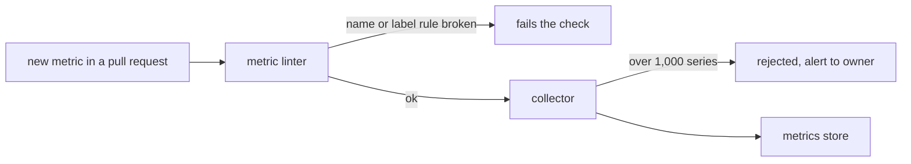

| Status | Stable |
| -- | -- |
| Version | 1.3 |
| Updated | 2026-03-03 |
| Owner | DemoGrace |
| Applies to | Every metric a service or job exports |

## Overview

Metrics follow OpenTelemetry semantic conventions where one exists, and the rules below where it does not. Consistent names let one dashboard and one alert rule work for every service.

## Name rules

| Rule | Good | Bad |
| -- | -- | -- |
| Lowercase, words joined with `_` | `cart_items_added_total` | `CartItemsAdded` |
| Unit as a suffix | `checkout_duration_seconds` | `checkout_time` |
| Counters end in `_total` | `payments_declined_total` | `payments_declined` |
| Base units only | seconds, bytes | milliseconds, megabytes |
| Domain first, then the measured thing | `orders_created_total` | `total_created_orders` |

## Labels

| Label | Allowed values | Notes |
| -- | -- | -- |
| `service` | service name | Added by the collector |
| `route` | the route template | `/orders/{id}`, never the real path |
| `status_class` | `2xx`, `4xx`, `5xx` | Not the exact code |
| `outcome` | short fixed set per metric | for example `approved`, `declined`, `error` |

A label value may never be an id, an email or free text. A metric with more than 1,000 label combinations is rejected by the collector.

## Standard metrics every service has

| Metric | Type | Labels |
| -- | -- | -- |
| `http_server_request_duration_seconds` | histogram | `route`, `method`, `status_class` |
| `http_server_requests_total` | counter | `route`, `method`, `status_class` |
| `rpc_server_duration_seconds` | histogram | `rpc_method`, `code` |
| `kafka_consumer_lag_records` | gauge | `topic`, `group` |
| `db_client_operation_duration_seconds` | histogram | `operation`, `table` |

Histogram buckets for request duration: 5 ms, 10 ms, 25 ms, 50 ms, 100 ms, 250 ms, 500 ms, 1 s, 2.5 s, 5 s.

## Example

```go
var paymentsDeclined = meter.Int64Counter(
    "payments_declined_total",
    metric.WithDescription("Payments the provider declined, by reason group"),
)

paymentsDeclined.Add(ctx, 1, metric.WithAttributes(
    attribute.String("outcome", "soft_decline"),
))
```

## Review



## Version history

| Version | Date | Change |
| -- | -- | -- |
| 1.0 | 2025-05-20 | First version |
| 1.2 | 2025-12-09 | Series limit per metric |
| 1.3 | 2026-03-03 | Metric linter in CI |

## Related

* [SPEC-008 Service level objective definitions](@SPEC-008)
* [SPEC-012 Canary analysis metrics](@SPEC-012)
