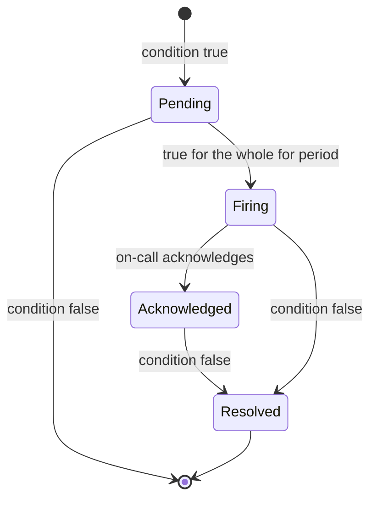

| Status | Stable |
| -- | -- |
| Version | 2.0 |
| Updated | 2026-03-31 |
| Owner | DemoKen |
| Applies to | Every alert that notifies a person |

## Overview

Every alert has an owner, a severity, a link to what to do, and a condition based on symptoms buyers or sellers feel. Alerts on causes (CPU, memory, a single pod restart) go to dashboards, not to people. Since version 2.0, availability alerts use error budget burn rates ([RFC-009](@RFC-009)).

## Required fields

| Field | Example | Rule |
| -- | -- | -- |
| `alert` | `CheckoutFastBurn` | CamelCase, starts with the service's domain |
| `expr` | PromQL | Must reference a symptom metric or an objective |
| `for` | `5m` | At least `2m` |
| `labels.severity` | `page`, `ticket` | Only two levels |
| `labels.team` | `checkout` | Must match the service manifest ([SPEC-001](@SPEC-001)) |
| `annotations.summary` | one sentence | Says what users see |
| `annotations.runbook` | document id | Required for `page` |

## Severities

| Severity | Delivery | Expected response |
| -- | -- | -- |
| `page` | phone notification to on-call, any hour | 15 minutes |
| `ticket` | ticket in the team's queue | next working day |

## Burn rate alerts

| Window | Burn rate | Budget used | Severity |
| -- | -- | -- | -- |
| 1 h and 5 min | 14.4 | 2 % | page |
| 6 h and 30 min | 6 | 5 % | page |
| 3 days and 6 h | 1 | 10 % | ticket |

## Example

```yaml
groups:
  - name: checkout-slo
    rules:
      - alert: CheckoutFastBurn
        expr: |
          slo:checkout_error_ratio:rate1h > (14.4 * 0.0005)
          and
          slo:checkout_error_ratio:rate5m > (14.4 * 0.0005)
        for: 2m
        labels:
          severity: page
          team: checkout
        annotations:
          summary: Checkout is failing for more buyers than its objective allows
          runbook: SPEC-008
```

## Life of an alert



## Version history

| Version | Date | Change |
| -- | -- | -- |
| 1.0 | 2025-06-10 | First version, threshold alerts |
| 1.1 | 2025-10-21 | Runbook required for pages |
| 2.0 | 2026-03-31 | Burn rate alerts for availability |

## Related

* [SPEC-008 Service level objective definitions](@SPEC-008)
* [ADR-033 Set service level objectives for customer-facing services](@ADR-033)
