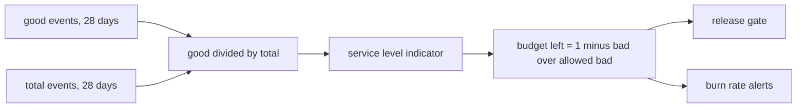

| Status | Stable |
| -- | -- |
| Version | 1.2 |
| Updated | 2026-03-17 |
| Owner | DemoKen |
| Applies to | Every service of tier `critical` or `standard` |

## Overview

A service level objective (SLO) states how good a service must be, measured from the user's side, over a rolling 28-day window. Each customer-facing service has at least an availability objective and a latency objective ([ADR-033](@ADR-033)). Error budgets and release freezes follow from them ([RFC-009](@RFC-009)).

## Definition file

Objectives live next to the service manifest, in `deploy/slo.yaml`:

```yaml
service: checkout-svc
window: 28d
objectives:
  - name: availability
    target: 99.95
    good: http_server_requests_total{route=~"/checkout.*",status_class!="5xx"}
    total: http_server_requests_total{route=~"/checkout.*"}
  - name: latency
    target: 99.0
    threshold: 800ms
    metric: http_server_request_duration_seconds{route="/checkout/confirm"}
```

| Field | Rule |
| -- | -- |
| `window` | Always `28d`, so every month has four full weeks |
| `target` | Percent of good events; at most two decimals |
| `good` / `total` | Counters from [SPEC-006](@SPEC-006); 4xx responses count as good |
| `threshold` | For latency objectives: a request is good if faster |

## Current objectives

| Service | Availability | Latency |
| -- | -- | -- |
| `checkout-svc` | 99.95 % | 99 % of confirms under 800 ms |
| `cart-svc` | 99.9 % | 99 % under 250 ms |
| `search-svc` | 99.9 % | 95 % under 300 ms |
| `catalog-svc` | 99.9 % | 99 % under 200 ms |
| `api-gateway` | 99.95 % | 99 % under 50 ms overhead ([RN-036](@RN-036)) |
| `notify-svc` | 99.5 % | 95 % of messages sent within 60 s |

## How budgets are computed



## What does not count against a service

| Case | Treatment |
| -- | -- |
| Requests rejected by rate limits ([ADR-034](@ADR-034)) | Good: the service worked as designed |
| Planned maintenance announced 7 days ahead | Excluded, at most 4 hours a quarter |
| Synthetic checks | Excluded by a header |

## Version history

| Version | Date | Change |
| -- | -- | -- |
| 1.0 | 2026-02-28 | First version with [ADR-033](@ADR-033) |
| 1.1 | 2026-03-10 | Latency objectives |
| 1.2 | 2026-03-17 | Maintenance exclusions |

## Related

* [SPEC-007 Alert rule format](@SPEC-007)
* [RN-011 Deployment frequency and change failure rate](@RN-011)
