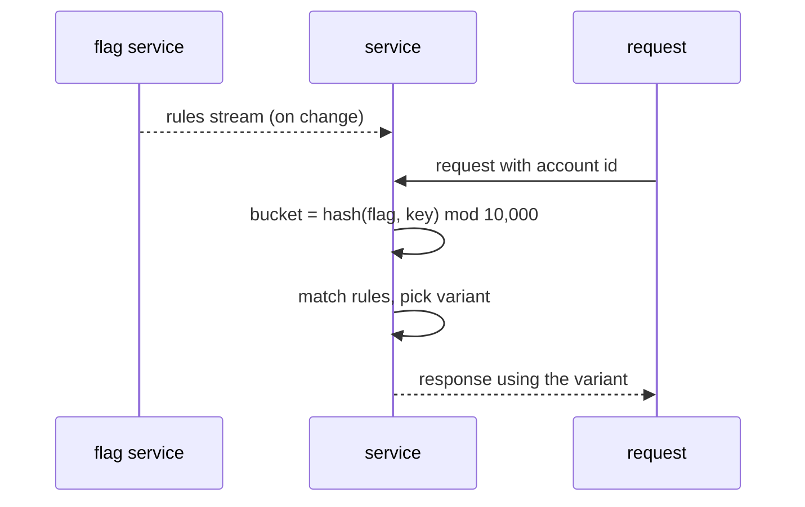

| Status | Stable |
| -- | -- |
| Version | 2.2 |
| Updated | 2026-06-09 |
| Owner | DemoHeidi |
| Applies to | Services, the web shop and the app |

## Overview

Every user-facing change ships behind a flag ([ADR-022](@ADR-022)). Services evaluate flags in process from a local copy of the rules, refreshed by streaming; no request waits on the flag service. The web shop and the app get their flag values in one call per session.

## Flag kinds

| Kind | Values | Example |
| -- | -- | -- |
| `boolean` | `true`, `false` | `checkout.one-page` |
| `variant` | named variants with weights | `search.ranking` with `control`, `ltr-v2` |
| `number` | a number with bounds | `cart.max-items` |

## Evaluation context

| Field | Type | Required | Notes |
| -- | -- | -- | -- |
| `key` | string | yes | Stable id for bucketing: account id, or device id when signed out |
| `country` | ISO 3166-1 alpha-2 | no | |
| `platform` | `web`, `ios`, `android`, `api` | no | |
| `app_version` | semantic version | no | For app-only rules |
| `seller_tier` | string | no | Seller Hub only |

No personal data goes into the context; the key is an opaque id.

## Server-side API

```go
enabled := flags.Bool(ctx, "checkout.one-page", flags.Context{
    Key:      accountID,
    Country:  "DE",
    Platform: "web",
}, false)

variant := flags.Variant(ctx, "search.ranking", evalCtx, "control")
```

The last argument is the default, used when the flag is missing or the local copy is older than 10 minutes.

## Client API

```http
GET /flags/v1/session HTTP/1.1
Host: flags.demomart.example.com
X-Device-Id: d_8c21f0
```

```json
{
  "flags": {
    "checkout.one-page": true,
    "search.ranking": "ltr-v2",
    "cart.max-items": 100
  },
  "ttlSeconds": 300
}
```

## Bucketing

A user's bucket is `sha256(flagKey + ":" + key) mod 10,000`, so the same user always sees the same variant of a flag, and different flags bucket independently.



## Limits

| Limit | Value |
| -- | -- |
| Flags per service | 200 |
| Rules per flag | 50 |
| Rule update to all services | under 5 s |
| Stale copy before defaults apply | 10 min |

## Version history

| Version | Date | Change |
| -- | -- | -- |
| 1.0 | 2025-10-14 | Boolean flags, polling |
| 2.0 | 2026-01-27 | Variants, streaming updates |
| 2.2 | 2026-06-09 | `seller_tier` context field |

## Related

* [RFC-001 Progressive delivery with canary releases](@RFC-001)
* [RN-042 One-page checkout experiment results](@RN-042)
