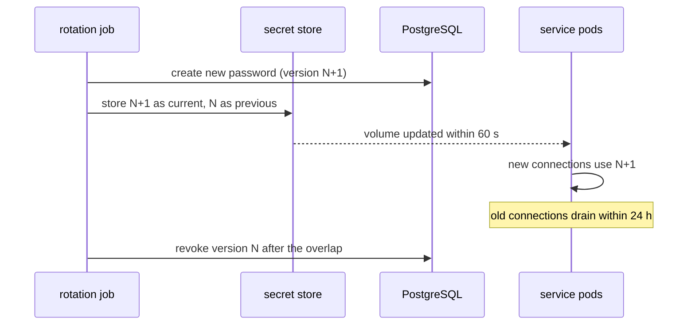

| Status | Stable |
| -- | -- |
| Version | 1.1 |
| Updated | 2026-10-06 |
| Owner | DemoLaura |
| Applies to | Database passwords, API keys, signing keys and service certificates |

## Overview

Secrets live in the managed secret store ([ADR-047](@ADR-047)) and reach pods through a CSI volume, never through images or the environments repository. Every secret is rotated on a schedule without downtime, using two valid versions at once.

## Rotation periods

| Secret kind | Period | Overlap of old and new | Rotated by |
| -- | -- | -- | -- |
| Database passwords | 30 days | 24 h | rotation job |
| Partner webhook signing keys ([ADR-018](@ADR-018)) | 180 days | 7 days | partner, in the portal |
| Third-party API keys | 90 days | 24 h | rotation job, where the provider allows |
| Service TLS certificates | 24 h | 1 h | certificate issuer |
| Encryption keys ([SPEC-029](@SPEC-029)) | 365 days | old version kept for decryption | key service |

## Protocol

Two versions, `current` and `previous`, are valid during the overlap.



## Service duties

* Read the secret file on every new connection, or watch it for changes; never cache it for the life of the process.
* Accept both versions when verifying (webhook signatures, tokens).
* Never log a secret ([SPEC-004](@SPEC-004)).

```go
watcher := secrets.Watch("/var/run/secrets/demo/db-password", func(v string) {
    pool.SetPassword(v) // used for new connections only
})
defer watcher.Close()
```

## Failure handling

| Failure | Detection | Action |
| -- | -- | -- |
| New version rejected by a service | connection errors rise after rotation | Job rolls back to `previous`, pages the owner |
| Store unreachable | volume not updated | Pods keep the last version; alert after 1 h |
| Overlap ends with old connections still open | count of sessions using version N | Revocation waits up to 6 h more, then forces |

## Version history

| Version | Date | Change |
| -- | -- | -- |
| 1.0 | 2026-09-08 | First version with [ADR-047](@ADR-047) |
| 1.1 | 2026-10-06 | Automatic rollback on rejected versions |

## Related

* [RFC-012 Typed configuration for services](@RFC-012)
* [ADR-028 Encrypt personal data at the field level](@ADR-028)
