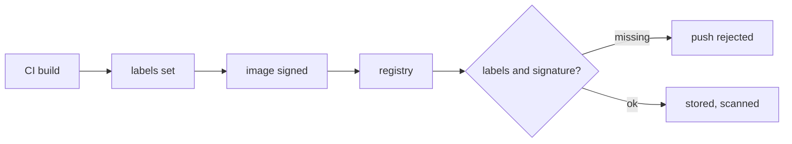

| Status | Stable |
| -- | -- |
| Version | 1.0 |
| Updated | 2025-11-11 |
| Owner | DemoMike |
| Applies to | Every image pushed to the company registry |

## Overview

Every image carries OCI labels that say what it is, where it came from and who owns it. The registry refuses images without the required labels, and the release gate refuses unsigned images ([SPEC-003](@SPEC-003)).

## Labels

| Label | Required | Example |
| -- | -- | -- |
| `org.opencontainers.image.source` | yes | `https://git.demomart.example.com/platform/monorepo` |
| `org.opencontainers.image.revision` | yes | full commit hash |
| `org.opencontainers.image.version` | yes | `2026.09.14-3` |
| `org.opencontainers.image.created` | yes | RFC 3339 build time |
| `com.demomart.service` | yes | `cart-svc` |
| `com.demomart.team` | yes | `checkout` |
| `com.demomart.base` | yes | `distroless-static-debian12` |

## Version format

`YYYY.MM.DD-N`, the build date and the build number of that day for that service. It sorts in time order and says how old a running image is at a glance.

## Setting labels in CI

```sh
docker buildx build \
  --label org.opencontainers.image.source="$REPO_URL" \
  --label org.opencontainers.image.revision="$COMMIT_SHA" \
  --label org.opencontainers.image.version="$IMAGE_VERSION" \
  --label org.opencontainers.image.created="$BUILD_TIME" \
  --label com.demomart.service=cart-svc \
  --label com.demomart.team=checkout \
  --label com.demomart.base=distroless-static-debian12 \
  --tag registry.demomart.example.com/cart-svc:"$IMAGE_VERSION" \
  --push .
```



## Registry rules

| Rule | Value |
| -- | -- |
| Tags are immutable | yes; a version is never pushed twice |
| `latest` tag | not allowed |
| Untagged images kept | 7 days |
| Images kept per service | the last 50 versions, plus any version running |

## Version history

| Version | Date | Change |
| -- | -- | -- |
| 1.0 | 2025-11-11 | First version with [RFC-013](@RFC-013) |

## Related

* [RFC-013 Smaller container images](@RFC-013)
* [RN-006 Container image sizes across services](@RN-006)
