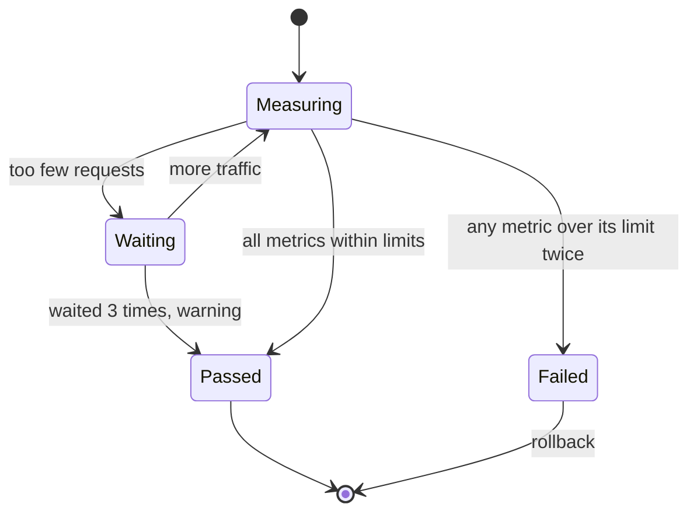

| Status | Stable |
| -- | -- |
| Version | 1.2 |
| Updated | 2026-04-21 |
| Owner | DemoErin |
| Applies to | Services released with the `canary` strategy |

## Overview

During a canary release ([RFC-001](@RFC-001)) the analysis compares the new version (canary) with the current one (stable) over the same minutes. Comparing with stable, not with a fixed threshold, keeps the analysis fair at any traffic level and time of day.

## Metrics

| Metric | Computed from | Fails when | Minimum requests |
| -- | -- | -- | -- |
| Error rate | 5xx responses over all responses | canary minus stable above 0.5 percentage points | 300 |
| p99 latency | request duration histogram | canary above 1.2 times stable | 300 |
| p50 latency | request duration histogram | canary above 1.3 times stable | 300 |
| Pod restarts | container restarts | any restart of a canary pod | |
| Consumer errors | failed event handlings | canary above 2 times stable | 50 events |

If a window has fewer requests than the minimum, the step waits up to three times longer, then passes with a warning.

## Queries

```yaml
metrics:
  - name: error-rate-delta
    query: |
      sum(rate(http_server_requests_total{service="{{service}}",track="canary",status_class="5xx"}[2m]))
        / sum(rate(http_server_requests_total{service="{{service}}",track="canary"}[2m]))
      -
      sum(rate(http_server_requests_total{service="{{service}}",track="stable",status_class="5xx"}[2m]))
        / sum(rate(http_server_requests_total{service="{{service}}",track="stable"}[2m]))
    failWhen: "> 0.005"
  - name: p99-ratio
    query: |
      histogram_quantile(0.99, sum by (le) (rate(http_server_request_duration_seconds_bucket{service="{{service}}",track="canary"}[2m])))
      /
      histogram_quantile(0.99, sum by (le) (rate(http_server_request_duration_seconds_bucket{service="{{service}}",track="stable"}[2m])))
    failWhen: "> 1.2"
```

The `track` label is set by the rollout controller on each pod.

## Decision per step



## Limits chosen from history

[RN-001](@RN-001) replayed six months of releases against these limits: they would have stopped 9 of the 11 bad releases, and wrongly stopped 4 of 486 good ones.

## Version history

| Version | Date | Change |
| -- | -- | -- |
| 1.0 | 2025-11-25 | Error rate and p99 |
| 1.1 | 2026-01-13 | Minimum request counts |
| 1.2 | 2026-04-21 | p50 ratio and consumer errors |

## Related

* [SPEC-006 Metric naming conventions](@SPEC-006)
* [SPEC-003 Deployment pipeline stages](@SPEC-003)
