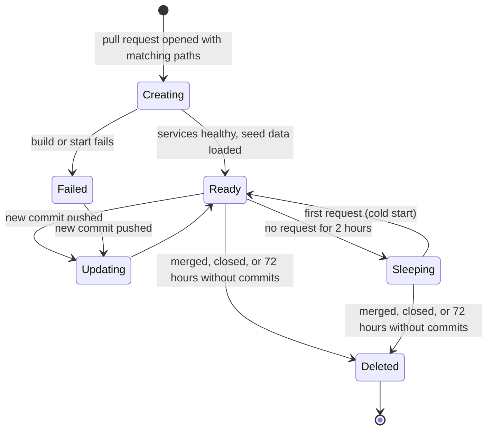

| Status | Draft |
| -- | -- |
| Version | 0.3 |
| Updated | 2026-09-22 |
| Owner | DemoMike |
| Applies to | Pull requests that change the web shop or a customer-facing service |

## Overview

A preview environment ([RFC-007](@RFC-007)) lives as long as its pull request is open and active, and costs nothing while nobody uses it. This draft fixes its states, its time limits and what the pull request shows.

## States



## Time limits

| Event | Limit |
| -- | -- |
| Creating to Ready | 8 min, else Failed |
| Updating to Ready | 5 min |
| Idle before Sleeping | 2 h |
| Waking from Sleeping | under 60 s |
| Without commits before Deleted | 72 h |
| Previews at the same time | 25; the oldest sleeping preview is deleted first |

## Pull request comment

The preview controller keeps one comment on the pull request up to date:

```markdown
Preview for this pull request: ready
https://pr-1234.preview.demomart.example.com

Built from commit 3f9a2c1 · services: web-shop, cart-svc · seed: demo-small
Sleeps after 2 hours idle · deleted 72 hours after the last commit
```

## Names

| Thing | Name |
| -- | -- |
| Namespace | `preview-pr-<number>` |
| Host | `pr-<number>.preview.demomart.example.com` |
| Routing header | `x-preview: pr-<number>` |
| Kafka consumer groups | `<group>-pr-<number>` |
| Database schemas | `pr_<number>` |

## Seed data

| Seed | Contents | Load time |
| -- | -- | -- |
| `demo-small` | 200 products, 3 sellers, 20 orders | 40 s |
| `demo-search` | 20,000 products for search changes | 4 min |

All seed data is generated; no copy of production data ever goes into a preview.

## Version history

| Version | Date | Change |
| -- | -- | -- |
| 0.1 | 2026-08-25 | States and limits |
| 0.2 | 2026-09-08 | Sleeping state |
| 0.3 | 2026-09-22 | Seed sets, consumer group names |

## Related

* [RFC-007 Preview environments for pull requests](@RFC-007)
* [SPEC-003 Deployment pipeline stages](@SPEC-003)
