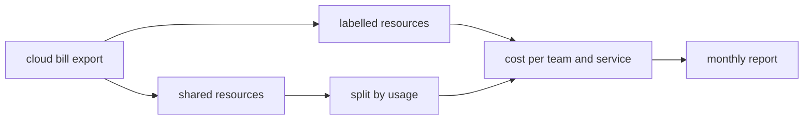

| Status | Stable |
| -- | -- |
| Version | 1.1 |
| Updated | 2026-02-17 |
| Owner | DemoNina |
| Applies to | Every Kubernetes workload and every cloud resource |

## Overview

Four labels on every workload and resource let the monthly bill be split by team, service and environment ([RFC-006](@RFC-006)). This specification fixes their names, values and how shared costs are divided.

## Labels

| Key | Values | Example | Required on |
| -- | -- | -- | -- |
| `demomart.example.com/team` | a team from the team list | `search` | everything |
| `demomart.example.com/service` | a service name, or `shared` | `search-svc` | workloads, volumes, databases, buckets |
| `demomart.example.com/env` | `production`, `staging`, `preview`, `ci` | `production` | everything |
| `demomart.example.com/cost-centre` | `cc-` and three digits | `cc-230` | everything |

Teams and cost centres:

| Team | Cost centre |
| -- | -- |
| platform | `cc-110` |
| data | `cc-120` |
| api | `cc-130` |
| checkout | `cc-210` |
| search | `cc-230` |
| mobile | `cc-240` |
| sellers | `cc-250` |

## Terraform

```hcl
provider "aws" {
  region = "eu-central-1"
  default_tags {
    tags = {
      "demomart.example.com/team"        = "search"
      "demomart.example.com/env"         = "production"
      "demomart.example.com/cost-centre" = "cc-230"
    }
  }
}
```

## Shared costs

| Cost | Split by |
| -- | -- |
| Shared node pools | each pod's CPU and memory requests, hourly |
| Load balancers and gateway | requests per service |
| Kafka cluster | bytes produced per topic owner |
| Network egress | bytes sent per service, from flow logs |
| Observability | log, metric and trace volume per service ([RN-009](@RN-009), [RN-010](@RN-010)) |



## Checks

| Check | Where | Effect |
| -- | -- | -- |
| Missing label on a workload | admission policy | rejected in production |
| Missing tag in a Terraform plan | CI | plan fails |
| Unknown team or cost centre | admission policy and CI | rejected |
| Unassigned share of the bill above 5 % | monthly report | ticket for the platform team |

## Version history

| Version | Date | Change |
| -- | -- | -- |
| 1.0 | 2025-11-04 | First version |
| 1.1 | 2026-02-17 | `preview` and `ci` environments |

## Related

* [RFC-006 Cost allocation labels for every workload](@RFC-006)
* [RN-008 Cost per request by service](@RN-008)
