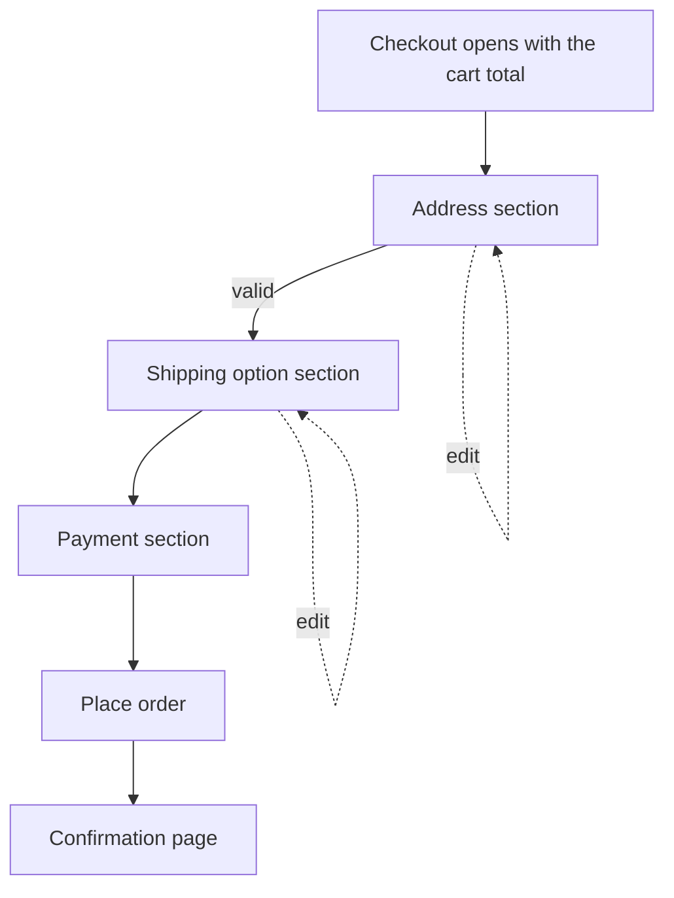

| Status | Implemented |
| -- | -- |
| Created | 2025-03-04 |
| Authors | DemoErin |
| Reviewers | DemoFrank, DemoHeidi, DemoJudy |
| Target | Q2 2025 |
| Evidence | [RN-041 Checkout drop-off by step](@RN-041), [RN-042 Experiment results](@RN-042) |

## Summary

Replace the five checkout pages (address, shipping, payment, review, confirmation) with one page whose sections open in turn, and show the full order total, with shipping and tax, from the moment checkout opens.

## Motivation

Only 41.3 % of sessions that open the cart place an order ([RN-041](@RN-041)). After sign-in, the largest losses are on the address step and on the review page, where 15.6 % of web buyers leave once they see the final total. Each page also costs a full server render and, on phones, about 1.4 seconds.

## Proposal

### One page, four sections

The page holds four sections: delivery address, shipping option, payment and the order summary. Only the first incomplete section is open; a completed section collapses to one line with an "Edit" action. The order summary is always visible: on the right on wide screens, at the bottom on phones.



### Totals from the start

`checkout-svc` returns a priced cart for every change. Before an address is known, shipping and tax are estimated from the buyer's market; the estimate is labelled as such and is replaced when the address is complete.

```json
{
  "cart_id": "crt_7Hq2",
  "items_total": { "amount": 4590, "currency": "EUR" },
  "shipping": { "amount": 495, "currency": "EUR", "estimated": true },
  "tax": { "amount": 966, "currency": "EUR", "estimated": true },
  "total": { "amount": 6051, "currency": "EUR" }
}
```

Amounts are integer minor units ([ADR-020](@ADR-020)). The full flow is specified in [SPEC-045](@SPEC-045).

### Same page, web and app

The web page and the app screen share the section order and the API calls. The app draws native sections; it does not embed the web page.

## Alternatives

| Option | Expected effect | Effort | Why not |
| -- | -- | -- | -- |
| Keep five pages, show the total on each | Removes the surprise at review | small | Keeps four page loads |
| Two pages: details, then review | Fewer loads | medium | The review page still loses buyers |
| **One page with sections** | **Fewest loads, total always visible** | **medium** | Chosen |
| Express checkout only (wallet buttons) | Fastest for wallet users | small | Only 8 to 14 % use wallets ([RN-043](@RN-043)) |

## Rollout

- [X] Build behind the `checkout.one_page` flag ([ADR-022](@ADR-022))
- [X] A/B test for 28 days, 50/50 ([RN-042](@RN-042))
- [X] Roll out to all buyers on 3 June 2025
- [X] Remove the five-page flow and its templates

## Open questions

* Should express wallet buttons sit above the address section? Answered: yes, for buyers whose wallet supplies an address; added in July 2025.
