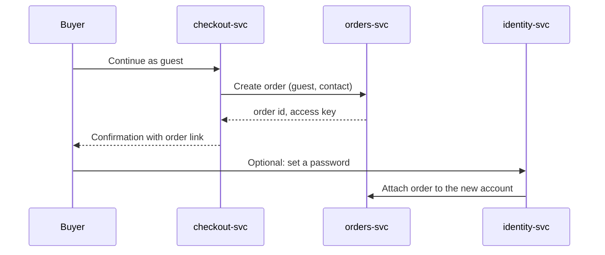

| Status | Implemented |
| -- | -- |
| Created | 2025-05-20 |
| Authors | DemoErin, DemoJudy |
| Reviewers | DemoKen, DemoGrace |
| Target | Q3 2025 |
| Evidence | [RN-047 Guest checkout conversion](@RN-047) |

## Summary

Let buyers place an order without an account. Checkout asks only for what the order needs, and the confirmation page offers to turn the order into an account with one password field.

## Motivation

21.6 % of checkout sessions end at the sign-in step ([RN-041](@RN-041)), the largest single loss in checkout. Among first-time buyers it is 34 %. Support hears the same reason every week: buyers do not want another account for one purchase.

## Proposal

### What a guest gives

A delivery address, a contact for order updates and a payment method. A guest order gets an `order_access_key`, a random 128-bit value; the order page link in the confirmation message carries it, so a guest can follow the order without signing in.

### Turning a guest into an account

The confirmation page asks for a password only. `identity-svc` creates the account from the order's contact and attaches every guest order with the same contact from the last 90 days.

### Abuse and fraud

Guest orders go through the same fraud checks ([SPEC-056](@SPEC-056)); the rules use device and payment signals, not account age. Guest orders are limited to 1,000 EUR.

## Alternatives

| Option | Effect on sign-in loss | Why not |
| -- | -- | -- |
| Social sign-in buttons | small | Many buyers decline to link accounts |
| Passwordless sign-in by one-time code | medium | Still an account; tested in 2024 with little effect |
| **Guest checkout** | **removes the step** | Chosen |

## Rollout

- [X] Guest checkout on the web behind `checkout.guest`
- [X] A/B test for 21 days ([RN-047](@RN-047))
- [X] All markets, web and app
- [X] Account offer on the confirmation page

## Open questions

* How long do we keep guest contact data? Agreed with the privacy review: 24 months after the last order, the same as for accounts ([SPEC-027](@SPEC-027)).
