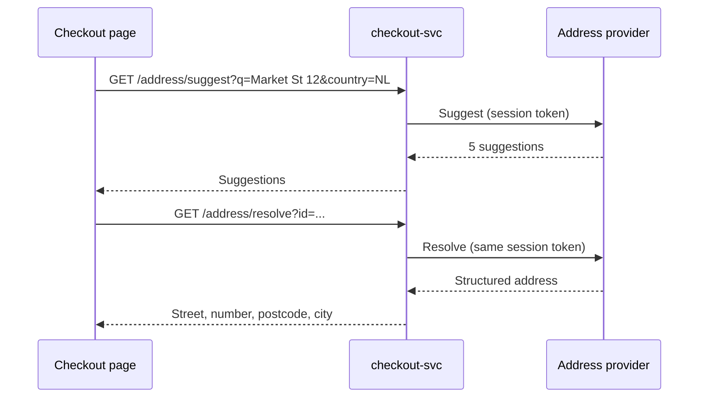

| Status | Implemented |
| -- | -- |
| Created | 2025-08-05 |
| Authors | DemoFrank |
| Reviewers | DemoErin, DemoLaura |
| Target | Q3 2025 |
| Evidence | [RN-046 Address autocomplete and failed deliveries](@RN-046) |

## Summary

Suggest complete, verified addresses while the buyer types in the address section of checkout, from an address lookup provider, and keep a typed-in address possible for every market.

## Motivation

31 % of address forms show at least one validation error ([RN-041](@RN-041)), the median time on the address step is 74 seconds on the web, and about 1 in 100 parcels fails because the address is wrong. A failed delivery costs 7.40 EUR on average.

## Proposal

### Lookup

`checkout-svc` proxies the lookup so the provider's key stays on the server and requests can be cached and rate limited. The client sends at most one request per 150 ms of typing, starting after three characters.

Suggestion and resolve calls share a session token, so the provider bills one lookup per address.

### Fallback

"Enter the address yourself" is always visible. A typed address is checked by postcode and city pattern only, and the order is never blocked by the provider.

### Limits

| Limit | Value |
| -- | -- |
| Suggest requests per checkout | 40 |
| Cache of suggestions | 24 h per query and country |
| Provider timeout | 400 ms, then hide suggestions |

## Alternatives

| Option | Why not |
| -- | -- |
| Browser autofill only | Fills stored data, which is often old |
| Postcode lookup only | Works in NL and PL, not in markets without detailed postcodes |
| Validate after submit | Finds errors late and still needs a lookup |

## Rollout

- [X] NL and DE first, behind `checkout.address_autocomplete`
- [X] All markets on 25 August 2025
- [X] Measure failed deliveries for seven weeks ([RN-046](@RN-046))

## Open questions

* Cost: 0.004 EUR per resolved address, about 2,600 EUR a month. Accepted against the delivery savings.
