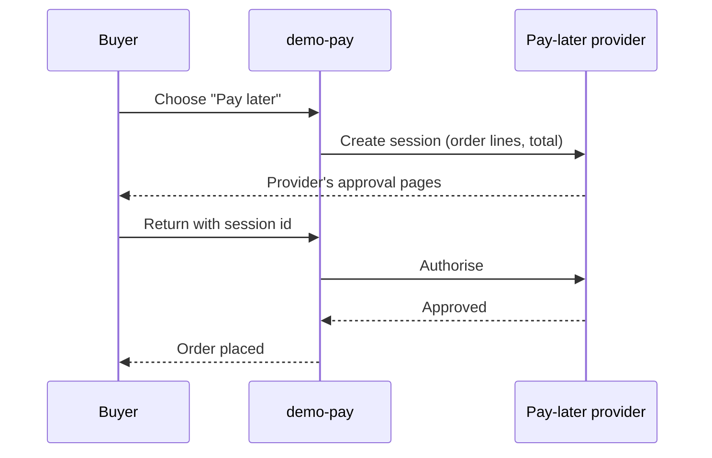

| Status | Rejected |
| -- | -- |
| Created | 2025-10-14 |
| Authors | DemoHeidi |
| Reviewers | DemoKen, DemoErin, DemoAlice |
| Target | Q1 2026 (not pursued) |
| Evidence | [RN-043 Payment method mix by country](@RN-043) |

## Summary

Offer a buy-now-pay-later provider as a payment method in DE: the buyer pays in instalments or after 30 days, the provider pays DemoMart in full and takes the credit risk. **Rejected** on cost; see Outcome.

## Motivation

1.4 % of support contacts about payment ask for paying later, mostly from DE ([RN-043](@RN-043)). Providers claim a conversion lift of 10 to 20 % on orders over 100 EUR, and our DE orders over 100 EUR are 22 % of DE revenue.

## Proposal

### Integration

The provider becomes a payment method type ([SPEC-049](@SPEC-049)) in `demo-pay`. The buyer is redirected to the provider, comes back with an approved session, and the payment intent is authorised as for any redirect method ([SPEC-048](@SPEC-048)).

### Order lines

The provider needs every order line with its price and tax, and is told of every partial refund and shipment, which `demo-pay` already sends to the card acquirer for split shipments ([RFC-046](@RFC-046)).

## Alternatives

| Option | Fee per order | Why not |
| -- | -- | -- |
| Provider A, instalments and 30 days | 3.9 % plus 0.30 EUR | Chosen for evaluation |
| Provider B, 30 days only | 2.9 % plus 0.35 EUR | No instalments |
| Our own invoice payment | none | Credit risk and collections are not our business |

## Outcome

The finance review compared the fee with the expected gain. At a 3.9 % fee against our card cost of 1.4 %, the method pays off only with a conversion lift above 14 % on the orders that use it. The provider's own pilot figures for marketplaces of our size showed 6 to 9 %. Rejected on 24 November 2025; we revisit if fees fall below 2.5 %.

## Rollout

- [ ] Not pursued

## Open questions

* None open; the decision is recorded above.
