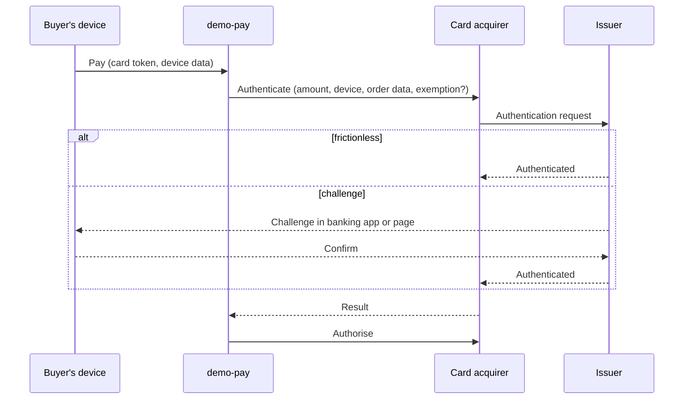

| Status | Implemented |
| -- | -- |
| Created | 2025-06-10 |
| Authors | DemoKen |
| Reviewers | DemoHeidi, DemoCarol |
| Target | Q3 2025 |
| Evidence | [RN-045 3-D Secure challenge rates](@RN-045) |

## Summary

Move card payments from 3-D Secure 1 to 3-D Secure 2, send the issuer the device and order data it needs for frictionless approval, and request exemptions where the rules allow them.

## Motivation

Strong customer authentication is required for card payments in our markets. With 3-D Secure 1 every payment shows the issuer's password page, and 28 % of buyers who see it do not finish. Version 2 lets the issuer approve most payments without a challenge, based on data we send with the request.

## Proposal

### Flow

### Data we send

| Data | Source | Why the issuer wants it |
| -- | -- | -- |
| Browser or app details | Checkout page or app SDK | Device recognition |
| Account age, orders in the last 6 months | identity-svc, orders-svc | Known customer |
| Delivery address matches billing | checkout-svc | Lower risk |
| Saved card used before | demo-pay | Known card |

### Exemptions

`demo-pay` requests an exemption in this order: low value (under 30 EUR), then transaction risk analysis by the card acquirer, when our fraud rate qualifies ([SPEC-056](@SPEC-056)). Liability for exempted payments moves to us.

### Result states

The payment intent gains the state `requires_action` while a challenge runs ([SPEC-048](@SPEC-048)). A challenge expires after 10 minutes.

## Alternatives

| Option | Why not |
| -- | -- |
| Stay on 3-D Secure 1 | Issuers in our markets drop it by end of 2025 |
| Challenge every payment on version 2 | Keeps the abandonment we want to remove |
| **Version 2 with exemptions** | Chosen |

## Rollout

- [X] Version 2 on the web, all cards, no exemptions
- [X] App SDK for in-app challenges
- [X] Exemption requests for half of eligible payments ([RN-045](@RN-045))
- [X] Exemptions for all eligible payments

## Open questions

* Should we stop requesting exemptions automatically when the monthly fraud rate on exempted payments passes 0.1 %? Proposed in the fraud check spec.
