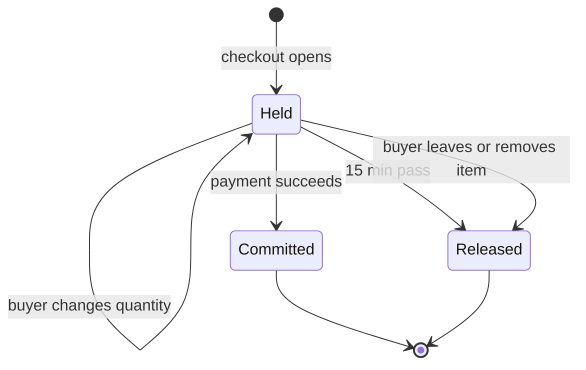

| Status | Accepted |
| -- | -- |
| Created | 2026-03-17 |
| Authors | DemoFrank, DemoIvan |
| Reviewers | DemoHeidi, DemoNina |
| Target | Q3 2026 |
| Decision | [ADR-013 Use Redis for carts and short-lived sessions](@ADR-013) |

## Summary

Reserve stock for the items in a buyer's cart from the moment checkout opens until payment succeeds or 15 minutes pass, so a buyer who has paid never gets an "item sold out" cancellation.

## Motivation

0.9 % of orders are cancelled because the last unit was sold to someone else between checkout and payment. During sales the rate reaches 4 % for popular items. Each such cancellation costs a refund, a support contact in a third of cases, and often the buyer.

## Proposal

### States of a reservation



### Where it lives

Reservations live in Redis next to the cart, one key per variant with a sorted set of holds by expiry. `catalog-svc` reports available stock as stock minus active holds. Committed holds become stock decrements in PostgreSQL in the same transaction as the order ([SPEC-054](@SPEC-054)).

```text
HSET hold:var_829:crt_7Hq2 qty 2 expires 1773740400
ZADD holds:var_829 1773740400 crt_7Hq2
```

### Limits

| Limit | Value | Why |
| -- | -- | -- |
| Hold time | 15 minutes | 96 % of checkouts finish within 12 minutes |
| Units per buyer per variant | 5 | Stops one buyer holding a whole drop |
| Extension | once, by 5 minutes, during a 3-D Secure challenge | Challenges take up to 10 minutes |

## Alternatives

| Option | Why not |
| -- | -- |
| Reserve on add to cart | Holds stock for carts that are never bought |
| Reserve in PostgreSQL rows | Row locks on hot items during sales |
| **Reserve at checkout, in Redis** | Chosen |

## Rollout

- [ ] Holds in shadow mode: compute but do not enforce
- [ ] Enforce for items with stock under 10
- [ ] Enforce for all items
- [ ] Seller Hub shows held units separately

## Open questions

* Should sellers' own stock feeds ([SPEC-080](@SPEC-080)) be allowed to reduce stock below held units? Proposed: yes, and the newest hold is released first.
