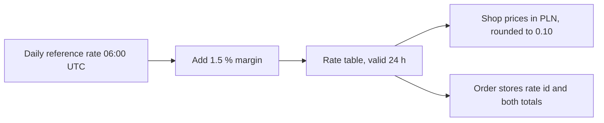

| Status | Draft |
| -- | -- |
| Created | 2026-10-06 |
| Authors | DemoLaura |
| Reviewers | DemoHeidi, DemoPeggy |
| Target | Q1 2027 |
| Evidence | [SPEC-058 Currency conversion](@SPEC-058) |

## Summary

Show prices to buyers in PL in zloty and charge in zloty, while sellers keep pricing and being paid in euro. DemoMart converts at a daily rate with a fixed margin and carries the exchange risk between order and payout.

## Motivation

PL is our third market by orders, and PL buyers pay in euro today. 23 % of PL buyers who open checkout leave at the payment step against 14 % in DE, and in a survey of 1,800 PL buyers the most named reason was "I do not know what my bank will charge".

## Proposal

### Prices and rates

* Display prices round to 0.10 PLN. The charged amount is the sum of rounded line prices, so what the buyer sees is what is charged.
* The order stores both totals and the rate id ([SPEC-058](@SPEC-058)). Refunds use the original rate.
* Sellers are paid the euro amount; the margin covers rate movement until payout.

### Scope

| Market | Currency | In scope |
| -- | -- | -- |
| PL | PLN | yes |
| Others outside the euro area | various | later, after PL |

## Alternatives

| Option | Why not |
| -- | -- |
| Show an estimate in PLN, charge in EUR | The bank's own rate still differs |
| Sellers set PLN prices | Few sellers want to manage two price lists |
| **Convert with a fixed margin** | Draft |

## Rollout

- [ ] Rate table in `demo-pay`
- [ ] PLN display in search and product pages
- [ ] PLN checkout and refunds
- [ ] Finance report of margin against rate movement

## Open questions

* Is 1.5 % enough? In 2025 the largest 10-day move was 2.1 %.
* Do PLN prices appear in search sorting by price? Proposed: yes, sorting uses converted prices.
