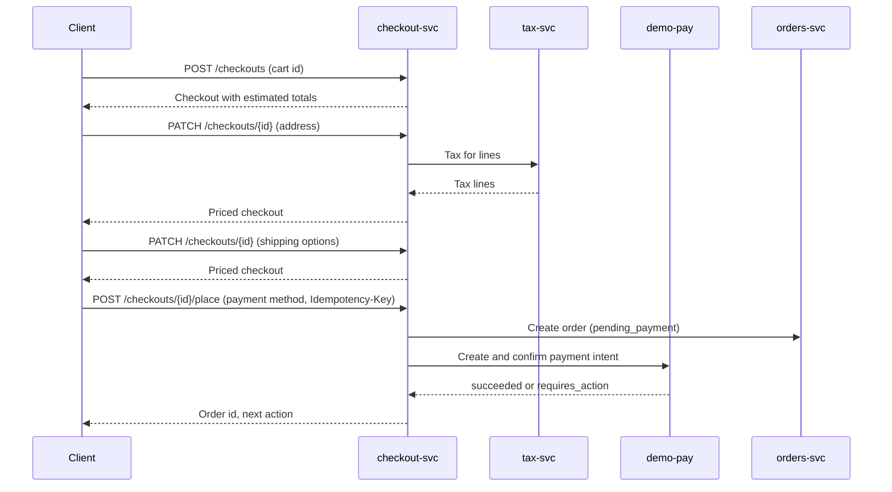

| Status | Stable |
| -- | -- |
| Version | 2.2 |
| Updated | 2026-03-30 |
| Owner | DemoErin |
| Applies to | checkout-svc, the web shop's checkout page and the app's checkout screen |

## Overview

Checkout is one page with four sections: delivery address, shipping option, payment and the order summary ([RFC-043](@RFC-043)). Every change sends the cart to `checkout-svc`, which answers with a priced cart; the client never computes totals. Placing the order creates a payment intent in `demo-pay` and an order in `orders-svc`.

## Sequence



## Checkout resource

| Field | Type | Description |
| -- | -- | -- |
| `id` | string | `chk_` followed by 12 characters |
| `cart_id` | string | The cart it was opened from ([SPEC-046](@SPEC-046)) |
| `version` | integer | Increases with every change; a PATCH must send the version it read |
| `address` | object or null | The delivery address once complete |
| `shipping_selections` | array | One per shipment group ([SPEC-051](@SPEC-051)) |
| `payment_method` | object or null | Type and token ([SPEC-049](@SPEC-049)) |
| `totals` | object | `items`, `shipping`, `discount`, `tax`, `total`; each a money object |
| `estimated` | boolean | True until the address is complete |
| `expires_at` | timestamp | 30 minutes after the last change |

A money object is `{ "amount": <integer minor units>, "currency": "<ISO 4217>" }` ([ADR-020](@ADR-020)).

## Placing the order

```json
{
  "checkout_id": "chk_4Fk20pQ7xRs1",
  "version": 9,
  "payment_method": { "type": "saved_card", "token": "vt_9fK2mQ" },
  "accepted_terms_version": "2026-01"
}
```

`place` is idempotent by the `Idempotency-Key` header ([ADR-019](@ADR-019)): a second call with the same key returns the first result.

## Errors

| Code | HTTP | When | Client action |
| -- | -- | -- | -- |
| `version_conflict` | 409 | The checkout changed since it was read | Reload and show changes |
| `item_unavailable` | 422 | A line is sold out ([SPEC-054](@SPEC-054)) | Show the line, offer removal |
| `address_unsupported` | 422 | No seller in the cart ships there | Ask for another address |
| `payment_declined` | 402 | Hard decline | Offer other methods |
| `checkout_expired` | 410 | Past `expires_at` | Reopen from the cart |

## Version history

| Version | Date | Change |
| -- | -- | -- |
| 1.0 | 2025-01-20 | Five-page flow |
| 2.0 | 2025-06-03 | One-page checkout |
| 2.1 | 2025-09-30 | Shipment groups for multi-seller carts |
| 2.2 | 2026-03-30 | `version` and `version_conflict` |

## Related

* [SPEC-047 Order state machine](@SPEC-047)
* [SPEC-048 Payment intents](@SPEC-048)
