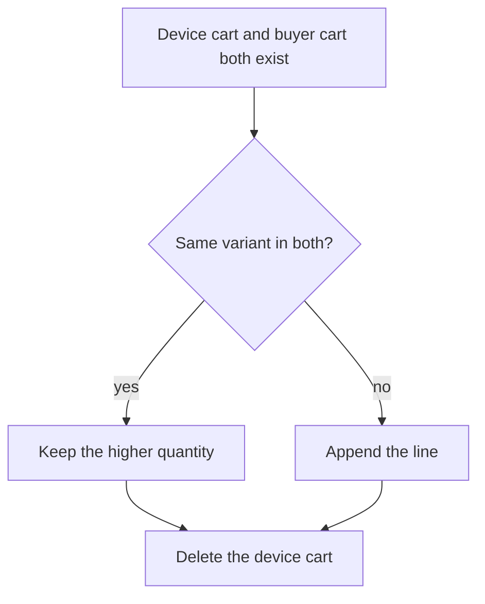

| Status | Stable |
| -- | -- |
| Version | 1.4 |
| Updated | 2026-01-12 |
| Owner | DemoFrank |
| Applies to | cart-svc and its Redis store |

## Overview

A cart belongs to a signed-in buyer or to a guest device. It lives in Redis ([ADR-013](@ADR-013)) as one hash per cart and one hash per line, with a time to live of 30 days after the last change. Carts are not orders: they hold prices for display only, and `checkout-svc` prices them again ([SPEC-045](@SPEC-045)).

## Cart

| Field | Type | Required | Description |
| -- | -- | -- | -- |
| `id` | string | yes | `crt_` followed by 10 characters |
| `owner` | string | yes | `buyer:<id>` or `device:<id>` |
| `market` | string | yes | Two-letter market code, sets currency and estimates |
| `currency` | string | yes | ISO 4217, from the market |
| `lines` | array | yes | Up to 50 lines |
| `updated_at` | timestamp | yes | Last change; reminders use it ([RN-048](@RN-048)) |
| `merged_from` | array | no | Device carts merged in at sign-in |

## Line

| Field | Type | Required | Description |
| -- | -- | -- | -- |
| `line_id` | string | yes | Stable within the cart |
| `variant_id` | string | yes | Catalog variant ([SPEC-024](@SPEC-024)) |
| `seller_id` | string | yes | Copied from the variant for grouping |
| `quantity` | integer | yes | 1 to 99 |
| `unit_price` | money | yes | Price when added, for display |
| `added_at` | timestamp | yes | |

## Example

```json
{
  "id": "crt_7Hq2Lm0aZx",
  "owner": "buyer:byr_31xQ",
  "market": "NL",
  "currency": "EUR",
  "lines": [
    { "line_id": "l1", "variant_id": "var_829", "seller_id": "sel_A", "quantity": 2, "unit_price": { "amount": 1295, "currency": "EUR" }, "added_at": "2026-01-09T18:21:04Z" },
    { "line_id": "l2", "variant_id": "var_114", "seller_id": "sel_C", "quantity": 1, "unit_price": { "amount": 3990, "currency": "EUR" }, "added_at": "2026-01-09T18:24:40Z" }
  ],
  "updated_at": "2026-01-09T18:24:40Z"
}
```

## Storage

```text
HSET cart:crt_7Hq2Lm0aZx owner buyer:byr_31xQ market NL currency EUR updated_at 1767983080
HSET cart:crt_7Hq2Lm0aZx:line:l1 variant_id var_829 seller_id sel_A quantity 2 unit_price 1295
EXPIRE cart:crt_7Hq2Lm0aZx 2592000
```

## Merging at sign-in



## Limits

| Limit | Value |
| -- | -- |
| Lines per cart | 50 |
| Quantity per line | 99 |
| Sellers per cart | 5 ([RFC-046](@RFC-046)) |
| Time to live | 30 days |

## Version history

| Version | Date | Change |
| -- | -- | -- |
| 1.0 | 2025-02-03 | First version |
| 1.2 | 2025-07-14 | `seller_id` on lines, five sellers per cart |
| 1.4 | 2026-01-12 | `merged_from` and merge rule |
