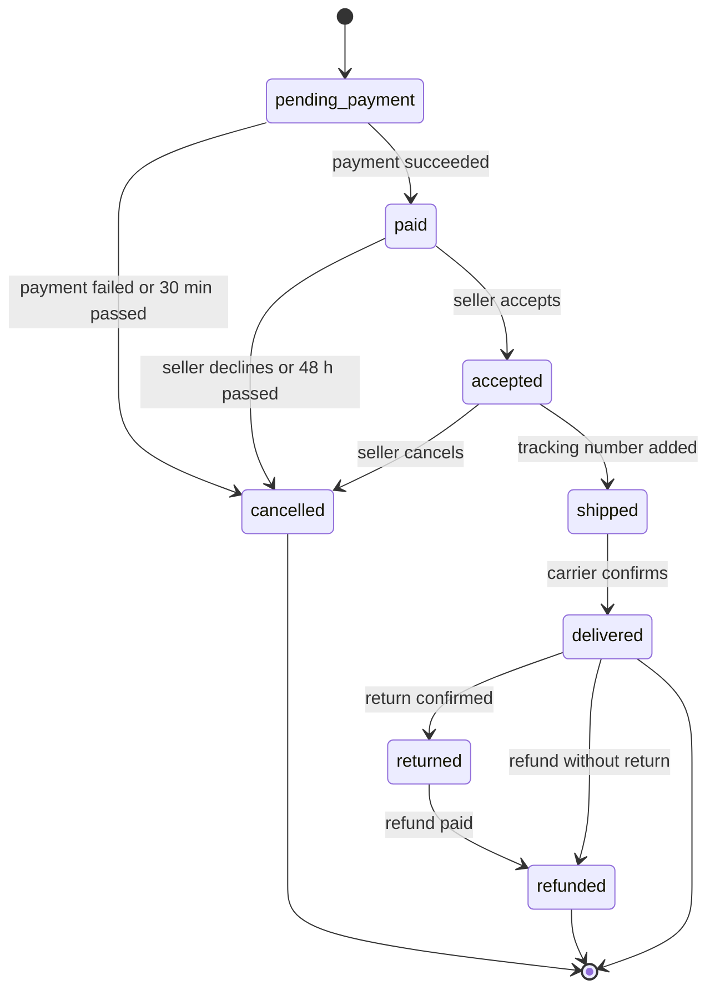

| Status | Stable |
| -- | -- |
| Version | 3.0 |
| Updated | 2025-10-21 |
| Owner | DemoIvan |
| Applies to | orders-svc, which owns every state change ([ADR-021](@ADR-021)) |

## Overview

An order has one state per shipment group ([RFC-046](@RFC-046)) and an order state derived from the groups. Only `orders-svc` changes states; other services ask it to, and learn about changes from order events ([SPEC-017](@SPEC-017)).

## Shipment group states



| State | Meaning | Who moves it on |
| -- | -- | -- |
| `pending_payment` | Created, payment not finished | demo-pay result |
| `paid` | Paid, waiting for the seller | Seller in Seller Hub or the API |
| `accepted` | The seller will ship | Seller |
| `shipped` | Handed to the carrier | Seller, with a tracking number |
| `delivered` | The carrier confirmed delivery | Carrier event |
| `returned` | The return arrived back | Seller or carrier event |
| `refunded` | Money returned ([SPEC-050](@SPEC-050)) | demo-pay result |
| `cancelled` | Will not ship; authorisation released | Buyer, seller or timeout |

## Order state

The order state is the earliest state among its groups that are not `cancelled`, in the order of the table above. If every group is cancelled, the order is `cancelled`.

## Transitions as commands

```json
{
  "command": "accept",
  "order_id": "ord_5Kd9",
  "shipment_group_id": "sg_2",
  "expected_state": "paid",
  "actor": { "type": "seller", "id": "sel_B" }
}
```

A command names the state it expects. If the group is in another state, `orders-svc` answers `409 state_conflict` and changes nothing.

## Timeouts

| From | After | To | Job |
| -- | -- | -- | -- |
| `pending_payment` | 30 minutes | `cancelled` | order-timeouts, every minute |
| `paid` | 48 hours | `cancelled` | order-timeouts |
| `shipped` | 30 days without delivery | stays, raises a support case | order-timeouts |

## Version history

| Version | Date | Change |
| -- | -- | -- |
| 1.0 | 2025-01-15 | One state per order |
| 2.0 | 2025-09-25 | States owned by orders-svc only ([ADR-021](@ADR-021)) |
| 3.0 | 2025-10-21 | Shipment groups |
