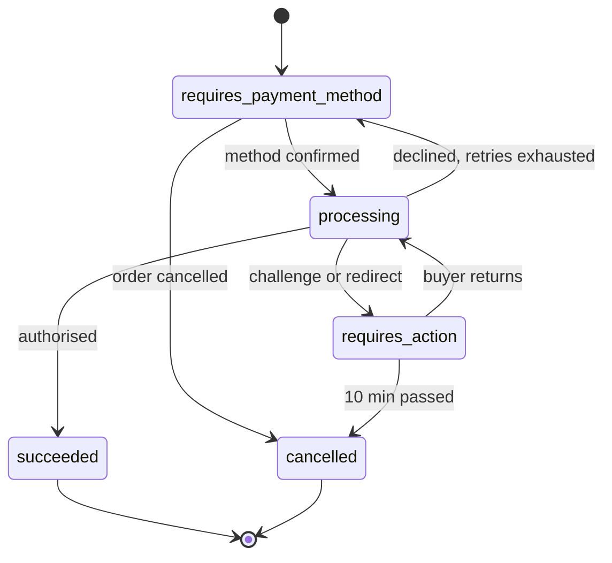

| Status | Stable |
| -- | -- |
| Version | 2.1 |
| Updated | 2026-05-19 |
| Owner | DemoHeidi |
| Applies to | demo-pay, the payment orchestrator for every method ([ADR-038](@ADR-038)) |

## Overview

A payment intent is the amount DemoMart wants to collect for one order. It tracks every attempt to pay that amount, whatever the method, until it succeeds, fails or is cancelled. Payment events ([SPEC-019](@SPEC-019)) are published on every state change.

## States



## Fields

| Field | Type | Description |
| -- | -- | -- |
| `id` | string | `pi_` and 12 characters |
| `order_id` | string | The order it pays |
| `amount` | money | Total to collect ([ADR-020](@ADR-020)) |
| `amount_captured` | money | Captured so far, per shipped group |
| `amount_refunded` | money | Refunded so far |
| `state` | string | See above |
| `method` | object | Type and token ([SPEC-049](@SPEC-049)) |
| `attempts` | array | One record per authorisation attempt, retries included ([RFC-050](@RFC-050)) |
| `next_action` | object or null | Challenge or redirect URL while `requires_action` |
| `created_at` | timestamp | |

## Example

```json
{
  "id": "pi_88QeT0mz41Lb",
  "order_id": "ord_5Kd9",
  "amount": { "amount": 6480, "currency": "EUR" },
  "amount_captured": { "amount": 2985, "currency": "EUR" },
  "amount_refunded": { "amount": 0, "currency": "EUR" },
  "state": "succeeded",
  "method": { "type": "card", "brand": "visa", "last4": "4242" },
  "attempts": [
    { "at": "2026-05-18T09:12:03Z", "result": "soft_decline", "reason": "issuer_unavailable" },
    { "at": "2026-05-18T09:12:06Z", "result": "authorised" }
  ]
}
```

## Capture

Authorisation covers the whole order. Each shipment group is captured when it ships, for its items and shipping. Groups cancelled before shipping release their part. Authorisations older than 6 days are captured or released by a nightly job, because card authorisations expire after 7.

## Limits

| Limit | Value |
| -- | -- |
| Amount per intent | 1 to 1,000,000 minor units |
| Attempts per intent | 10 |
| Time in `requires_action` | 10 minutes |

## Version history

| Version | Date | Change |
| -- | -- | -- |
| 1.0 | 2025-02-10 | Card payments |
| 1.3 | 2025-07-01 | `requires_action` for 3-D Secure 2 ([RFC-049](@RFC-049)) |
| 2.0 | 2025-10-21 | Partial capture per shipment group |
| 2.1 | 2026-05-19 | `attempts` for retries |
