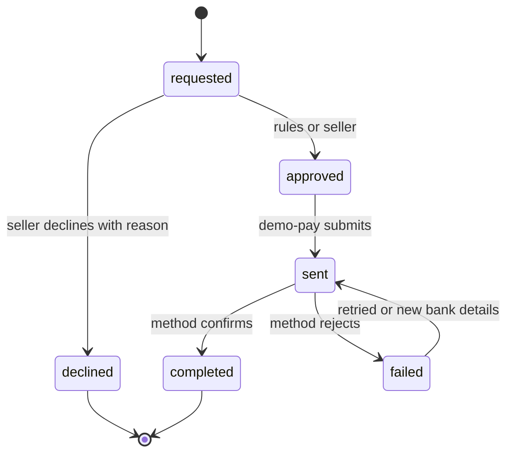

| Status | Stable |
| -- | -- |
| Version | 2.0 |
| Updated | 2026-06-01 |
| Owner | DemoLaura |
| Applies to | demo-pay, orders-svc, Seller Hub and the buyer's order page |

## Overview

A refund returns money for some or all lines of one shipment group. It can be requested by the buyer, approved by rules or by the seller ([RFC-053](@RFC-053)), and is paid to the original method. A refund never exceeds what was captured for the group.

## Lifecycle



## Refund resource

| Field | Type | Description |
| -- | -- | -- |
| `id` | string | `rfd_` and 12 characters |
| `order_id`, `shipment_group_id` | string | What is refunded |
| `lines` | array | Line ids and quantities; empty for shipping only |
| `amount` | money | Items, their tax and, if the whole group is refunded, its shipping |
| `reason` | string | `returned`, `damaged`, `not_received`, `wrong_item`, `goodwill` |
| `approved_by` | string | `rules`, `seller` or `support` |
| `state` | string | See above |

```json
{
  "id": "rfd_k2Pq90LmAa1x",
  "order_id": "ord_5Kd9",
  "shipment_group_id": "sg_2",
  "lines": [{ "line_id": "l3", "quantity": 1 }],
  "amount": { "amount": 1590, "currency": "EUR" },
  "reason": "returned",
  "approved_by": "rules",
  "state": "sent"
}
```

## Amount rules

* Line amounts are refunded at the price paid, after discounts ([SPEC-053](@SPEC-053)), with the tax line of that quantity ([SPEC-052](@SPEC-052)).
* Shipping is refunded only with the last line of the group, or for `damaged`, `not_received` and `wrong_item`.
* Rounding: line amounts are computed per unit and multiplied, so two partial refunds equal one full refund.

## Times

| Method | Expected time to money returned |
| -- | -- |
| Card, saved card | 3 to 5 days |
| Wallet | 1 to 3 days |
| Bank transfer | 2 to 6 days |
| Voucher balance | at once |

Measured times are in [RN-050](@RN-050).

## Version history

| Version | Date | Change |
| -- | -- | -- |
| 1.0 | 2025-02-10 | Whole order refunds |
| 1.1 | 2025-10-21 | Per shipment group |
| 2.0 | 2026-06-01 | `approved_by: rules` for self-service |
