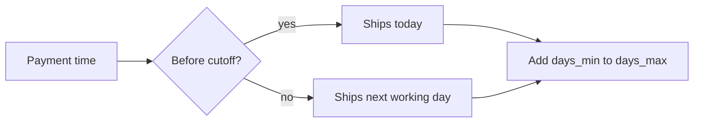

| Status | Stable |
| -- | -- |
| Version | 1.3 |
| Updated | 2025-11-18 |
| Owner | DemoFrank |
| Applies to | checkout-svc, Seller Hub shipping settings |

## Overview

Each seller defines shipping profiles in Seller Hub. At checkout every shipment group ([RFC-046](@RFC-046)) offers the options of its seller's profile that serve the delivery country, priced by the profile's rules. The buyer picks one option per group.

## Shipping profile

| Field | Type | Description |
| -- | -- | -- |
| `id` | string | `shp_` and 8 characters |
| `seller_id` | string | Owner |
| `options` | array | Up to 4 options |
| `free_over` | money or null | Group items total from which the cheapest option is free |

## Option

| Field | Type | Description |
| -- | -- | -- |
| `code` | string | `standard`, `express`, `locker` or `pickup` |
| `countries` | array | Countries served |
| `base_price` | money | For the first item |
| `extra_item_price` | money | For each further item |
| `days_min`, `days_max` | integer | Delivery estimate in working days after shipping |
| `cutoff_local` | string | Orders paid before this time ship the same day, for example `14:00` |

```json
{
  "code": "standard",
  "countries": ["DE", "AT", "NL"],
  "base_price": { "amount": 495, "currency": "EUR" },
  "extra_item_price": { "amount": 100, "currency": "EUR" },
  "days_min": 2,
  "days_max": 4,
  "cutoff_local": "14:00"
}
```

## Price of an option

```text
price = base_price + extra_item_price * (items - 1)
price = 0 if free_over is set and group items total >= free_over and option is the cheapest
```

## Delivery estimate



Working days follow the seller's country calendar.

## Errors

| Code | When |
| -- | -- |
| `no_option_for_country` | The seller does not ship to the address; the group cannot be ordered |
| `option_changed` | The seller changed the profile during checkout; prices are reloaded |

## Version history

| Version | Date | Change |
| -- | -- | -- |
| 1.0 | 2025-02-17 | Per-order shipping |
| 1.2 | 2025-10-21 | Per shipment group |
| 1.3 | 2025-11-18 | `locker` and `pickup` codes |
