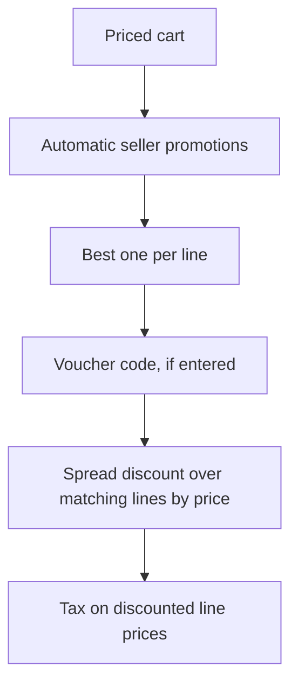

| Status | Stable |
| -- | -- |
| Version | 1.2 |
| Updated | 2026-04-06 |
| Owner | DemoErin |
| Applies to | checkout-svc, Seller Hub promotions, marketing campaigns |

## Overview

A promotion lowers the price of lines that match its conditions. Sellers fund their own promotions; DemoMart funds marketplace vouchers. Discounts are spread over the matching lines, so refunds and tax work per line ([SPEC-050](@SPEC-050), [SPEC-052](@SPEC-052)).

## Promotion

| Field | Type | Description |
| -- | -- | -- |
| `id` | string | `prm_` and 8 characters |
| `funded_by` | string | `seller` or `marketplace` |
| `kind` | string | `percent_off`, `amount_off`, `free_shipping` |
| `value` | integer | Basis points for `percent_off`, minor units for `amount_off` |
| `conditions` | object | Minimum items total, categories, sellers, first order only |
| `code` | string or null | Voucher code; null for automatic promotions |
| `max_uses`, `max_uses_per_buyer` | integer | Limits |
| `starts_at`, `ends_at` | timestamp | |

```json
{
  "id": "prm_aut26x01",
  "funded_by": "marketplace",
  "kind": "amount_off",
  "value": 1000,
  "conditions": { "min_items_total": { "amount": 5000, "currency": "EUR" }, "first_order_only": true },
  "code": "WELCOME10",
  "max_uses": 20000,
  "max_uses_per_buyer": 1,
  "starts_at": "2026-04-06T00:00:00Z",
  "ends_at": "2026-05-31T23:59:59Z"
}
```

## Applying promotions



* At most one seller promotion and one marketplace voucher per line.
* A spread discount is split in proportion to line prices; the remainder of rounding goes to the most expensive line.

## Errors

| Code | Message to the buyer |
| -- | -- |
| `voucher_unknown` | This code does not exist |
| `voucher_expired` | This code has expired |
| `voucher_conditions_not_met` | Add 12.50 EUR more to use this code (amount computed) |
| `voucher_used` | You have already used this code |

## Version history

| Version | Date | Change |
| -- | -- | -- |
| 1.0 | 2025-03-10 | Seller promotions |
| 1.1 | 2025-08-25 | Marketplace vouchers |
| 1.2 | 2026-04-06 | First-order condition |
