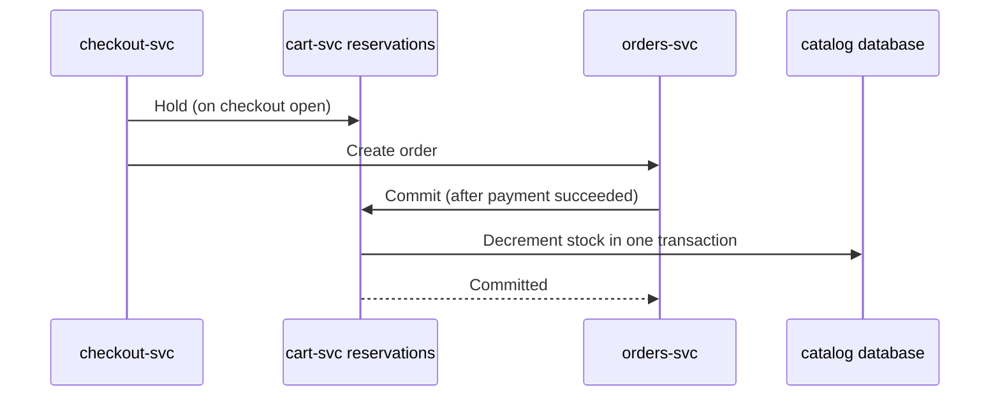

| Status | Draft |
| -- | -- |
| Version | 0.3 |
| Updated | 2026-04-21 |
| Owner | DemoIvan |
| Applies to | cart-svc, catalog-svc, orders-svc |

## Overview

The interface for holding stock during checkout, as proposed in [RFC-052](@RFC-052). A hold reserves units of a variant for one checkout for 15 minutes. Available stock is stock minus active holds.

## Operations

| Operation | Input | Result |
| -- | -- | -- |
| `Hold` | checkout id, variant id, quantity | `held` with expiry, or `insufficient` with available units |
| `Extend` | checkout id | New expiry, once, by 5 minutes |
| `Commit` | checkout id, order id | Holds become stock decrements |
| `Release` | checkout id | Holds removed |

```protobuf
service Reservations {
  rpc Hold(HoldRequest) returns (HoldResponse);
  rpc Extend(ExtendRequest) returns (ExtendResponse);
  rpc Commit(CommitRequest) returns (CommitResponse);
  rpc Release(ReleaseRequest) returns (ReleaseResponse);
}

message HoldRequest {
  string checkout_id = 1;
  string variant_id = 2;
  int32 quantity = 3;
}
```

## Sequence at payment



## Available stock

```text
available(variant) = stock(variant) - sum(active holds of variant)
```

`catalog-svc` serves `available` to product pages and search. Holds expire lazily: an expired hold is removed when the variant's holds are next read, and by a sweep every minute.

## Limits

| Limit | Value |
| -- | -- |
| Hold time | 15 minutes |
| Units per checkout per variant | 5 |
| Extensions | 1 |

## Open points

* Behaviour when a seller's stock feed lowers stock below held units ([SPEC-080](@SPEC-080)).
