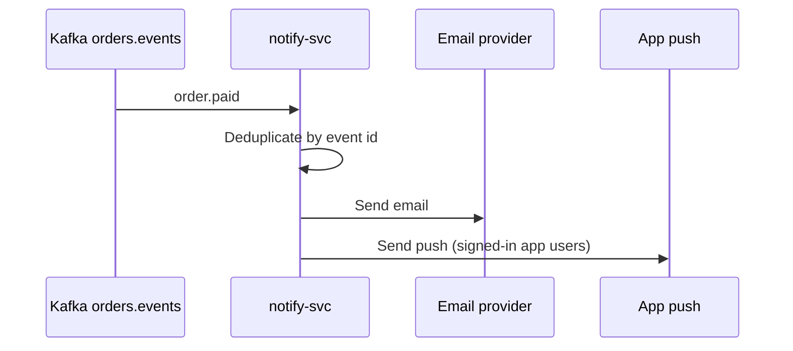

| Status | Stable |
| -- | -- |
| Version | 2.0 |
| Updated | 2026-05-20 |
| Owner | DemoErin |
| Applies to | notify-svc ([ADR-039](@ADR-039)), order events |

## Overview

The order confirmation message is sent by `notify-svc` when it reads `orders.order.paid.v1` ([SPEC-017](@SPEC-017)). It goes to the contact given at checkout, by email, and as a push message in the app when the buyer is signed in there.

## Content

| Block | Content | Source |
| -- | -- | -- |
| Subject | "Your DemoMart order {order number}" | order |
| Greeting | "Thank you for your order" (no name) | fixed |
| Summary | Items with image, quantity and price per shipment group | order lines |
| Totals | Items, shipping, discount, tax, total | order totals |
| Delivery | Estimate per group ([SPEC-051](@SPEC-051)) | shipment groups |
| Actions | "View your order"; for guests, "Create an account" | order access link |

## Template data

```json
{
  "template": "order_confirmation",
  "locale": "nl-NL",
  "order_number": "DM-2026-0518-4471",
  "order_url": "https://shop.example.com/orders/ord_5Kd9",
  "groups": [
    { "seller_display_name": "Seller A", "items": 2, "estimate": { "from": "2026-05-20", "to": "2026-05-22" } }
  ],
  "totals": {
    "items": { "amount": 5590, "currency": "EUR" },
    "shipping": { "amount": 495, "currency": "EUR" },
    "total": { "amount": 6085, "currency": "EUR" }
  },
  "guest": false
}
```

Amounts are formatted by locale in the template, never before.

## Delivery rules



* Sent at most once per order, deduplicated by the event id.
* If the email provider fails, retried for 2 hours with backoff.
* Guests' order links carry the order access key ([RFC-045](@RFC-045)) and expire after 180 days.

## Version history

| Version | Date | Change |
| -- | -- | -- |
| 1.0 | 2025-01-20 | Sent by orders-svc |
| 1.2 | 2025-10-21 | Per shipment group |
| 2.0 | 2026-05-20 | Moved to notify-svc |
