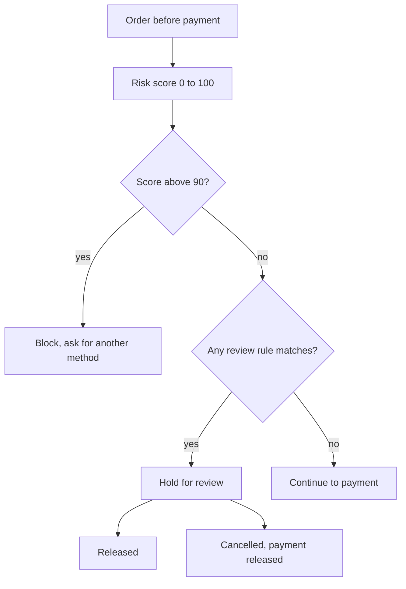

| Status | Stable |
| -- | -- |
| Version | 2.0 |
| Updated | 2026-03-02 |
| Owner | DemoKen |
| Applies to | demo-pay, orders-svc, the review console |

## Overview

Every order is scored before payment confirmation. The score and a set of rules decide whether the order goes ahead, goes to manual review, or is blocked. Version 2.0 changed two rules after [RN-049](@RN-049) showed they caused most false positives.

## Decision flow

## Signals

| Signal | Source |
| -- | -- |
| Device score | Device fingerprint from the checkout page or app |
| Card or token seen with chargebacks | demo-pay history |
| Orders from this device and card in 24 h | demo-pay counters |
| Account age and order history | identity-svc, orders-svc |
| Billing and delivery countries | checkout |

## Review rules (version 2.0)

| Rule | Condition |
| -- | -- |
| Country mismatch | Billing and delivery countries differ and one is outside the EU |
| New account, large order | Account under 7 days, order over 600 EUR, device score above 40 |
| Card velocity | Three or more cards tried from one device in one hour |
| Chargeback device | Device seen with a chargeback in 180 days |

Removed in 2.0: the country mismatch rule within the EU, and the 300 EUR new-account rule.

## Review

Reviewers see the signals and release or cancel. Target time: 90 % of reviews within 4 hours, 07:00 to 23:00.

## Exemptions and fraud rate

The monthly fraud rate on payments exempted from 3-D Secure ([RFC-049](@RFC-049)) is reported. Above 0.1 % of value, exemptions are switched off for the next month.

## Version history

| Version | Date | Change |
| -- | -- | -- |
| 1.0 | 2025-03-03 | Score and five rules |
| 1.2 | 2025-07-22 | Guest orders scored like account orders |
| 2.0 | 2026-03-02 | Two rules changed after [RN-049](@RN-049) |
