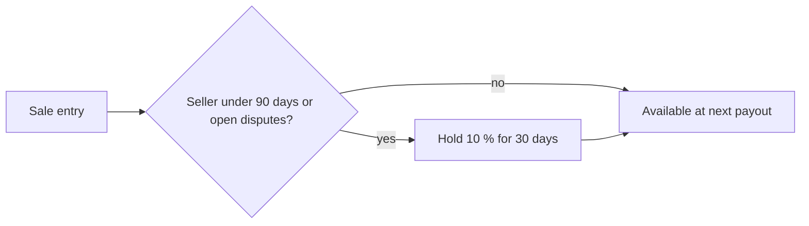

| Status | Stable |
| -- | -- |
| Version | 1.3 |
| Updated | 2026-06-15 |
| Owner | DemoLaura |
| Applies to | demo-pay payouts, Seller Hub balance page |

## Overview

DemoMart collects the buyer's payment and pays each seller their share. A seller's balance grows when a shipment group is delivered and shrinks with refunds and fees. Balances are paid out on the seller's schedule ([SPEC-081](@SPEC-081)).

## Ledger entries

| Entry | When | Amount |
| -- | -- | -- |
| `sale` | Group delivered, or 14 days after shipping | Items and shipping, after seller-funded discounts |
| `commission` | With each sale | Negative, by category rate |
| `payment_fee` | With each sale | Negative, 1.2 % of the sale |
| `refund` | Refund completed ([SPEC-050](@SPEC-050)) | Negative, the refunded amount |
| `commission_refund` | With each refund | Positive, the commission on the refunded amount |
| `payout` | Payout sent | Negative, the paid balance |

## Example balance

| Entry | Amount (EUR) |
| -- | -- |
| sale ord_5Kd9 sg_1 | 30.85 |
| commission 12 % on items | −3.11 |
| payment fee 1.2 % | −0.37 |
| sale ord_6Ab2 sg_1 | 54.00 |
| commission 12 % on items | −6.48 |
| payment fee 1.2 % | −0.65 |
| **Balance** | **74.24** |

Amounts are stored in minor units ([ADR-020](@ADR-020)); the table shows them in euro.

## Ledger record

```json
{
  "entry_id": "led_01J9X2",
  "seller_id": "sel_A",
  "type": "sale",
  "order_id": "ord_5Kd9",
  "shipment_group_id": "sg_1",
  "amount": { "amount": 3085, "currency": "EUR" },
  "available_at": "2026-06-12T00:00:00Z"
}
```

## Holding back



## Reconciliation

Payouts and payment captures are reconciled continuously ([ADR-049](@ADR-049), [RFC-025](@RFC-025)). A ledger entry without a matching capture blocks the next payout.

## Version history

| Version | Date | Change |
| -- | -- | -- |
| 1.0 | 2025-02-24 | Payout per order |
| 1.2 | 2025-10-21 | Per shipment group |
| 1.3 | 2026-06-15 | Reserve for new sellers |
