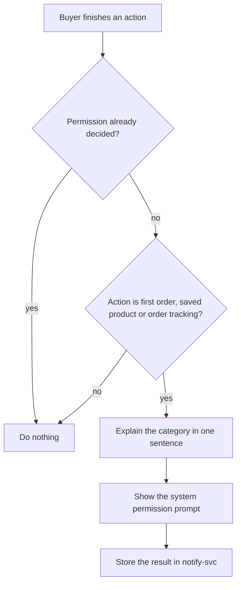

| Status | Implemented |
| -- | -- |
| Created | 2026-05-25 |
| Authors | DemoPeggy |
| Reviewers | DemoNina, DemoLaura |
| Target | App 5.14, Q3 2026 |
| Decision | [ADR-039 Send all notifications through notify-svc](@ADR-039) |

## Summary

Replace the single on-off switch for push notifications with five categories that buyers turn on and off separately, store the choices in `notify-svc`, and ask for the operating system's permission at the moment a category becomes useful instead of on first launch.

## Motivation

* 23 % of buyers who allowed notifications turned them off within 30 days. In a survey of 1,200 of them, 71 % said they wanted order updates but not marketing.
* The app asks for permission on first launch. Only 38 % of iOS users and 52 % of Android users allow it there ([RN-063](@RN-063)).
* Each team sends its own pushes from its own service, so there is no single place to honour a buyer's choice. [ADR-039](@ADR-039) moves all sending to `notify-svc`.

## Proposal

### Categories

| Category | Examples | Default | Can be turned off |
| -- | -- | -- | -- |
| `order_updates` | Shipped, out for delivery, delivered | on | yes |
| `price_drops` | A saved product is cheaper | on | yes |
| `back_in_stock` | A saved product is available again | on | yes |
| `messages` | A seller answered a question | on | yes |
| `promotions` | Campaigns and vouchers | off | yes |

Security messages (new sign-in, password change) are not push notifications; they go by email and in-app inbox.

### Storage and sending

`notify-svc` stores one row per buyer and category, and checks it before every push. The payload carries the category so the app can group notifications ([SPEC-070](@SPEC-070)).

```json
{
  "buyer_id": "b_01J8Z6Q3M4",
  "preferences": {
    "order_updates": true,
    "price_drops": true,
    "back_in_stock": false,
    "messages": true,
    "promotions": false
  },
  "updated_at": "2026-07-02T09:14:00Z"
}
```

### When to ask



On Android, channels map one to one to the categories, so the buyer can also change them in system settings; the app reads them back on start.

## Alternatives

| Option | Fine-grained | Works across devices | Why not |
| -- | -- | -- | -- |
| Keep one switch | no | yes | The problem we have |
| OS channels only | Android only | no | Nothing for iOS; lost on reinstall |
| **Categories in notify-svc** | **yes** | **yes** | Chosen |

## Rollout

- [X] Preferences table and API in `notify-svc`
- [X] Settings screen in the app behind the `push_categories` flag
- [X] Move permission prompt to the three moments above
- [X] Migrate all senders to `notify-svc`
- [X] Turn `promotions` off for everyone who never chose

## Open questions

* Quiet hours per buyer? Measured demand is low; not in this RFC.
