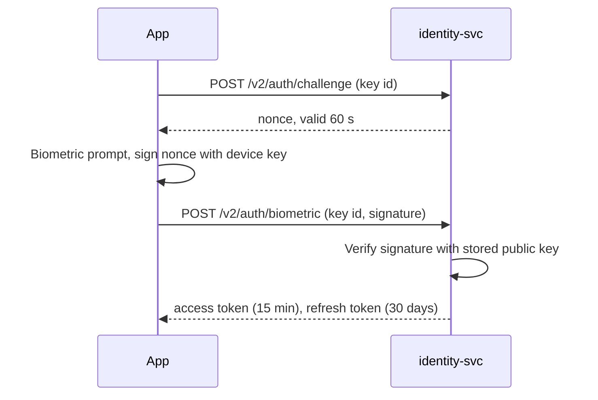

| Status | Implemented |
| -- | -- |
| Created | 2026-02-10 |
| Authors | DemoFrank |
| Reviewers | DemoGrace, DemoNina, DemoPeggy |
| Target | App 5.4, Q1 2026 |
| Evidence | [RN-067 Biometric sign-in adoption](@RN-067) |

## Summary

Let buyers sign in again with Face ID, Touch ID or Android biometrics instead of their password, by keeping a device-bound key in the secure hardware and proving possession of it to `identity-svc`.

## Motivation

* App sessions expire after 30 days of inactivity, and 18 % of buyers who hit the sign-in screen at checkout leave without signing in.
* Password resets are the most common reason for contacting support from the app: 9,400 in September 2025.
* Both platforms offer hardware-backed keys that leave the device never, so we can avoid storing a password or a long-lived token on the phone.

## Proposal

### Enrolment

After a normal sign-in, the app offers biometric sign-in. If the buyer accepts, it creates a key pair in the Secure Enclave (iOS) or the Android Keystore with user authentication required, and registers the public key with `identity-svc`.

```swift
let access = SecAccessControlCreateWithFlags(nil,
    kSecAttrAccessibleWhenUnlockedThisDeviceOnly, [.privateKeyUsage, .biometryCurrentSet], nil)!
let attributes: [String: Any] = [
    kSecAttrKeyType as String: kSecAttrKeyTypeECSECPrimeRandom,
    kSecAttrKeySizeInBits as String: 256,
    kSecAttrTokenID as String: kSecAttrTokenIDSecureEnclave,
    kSecPrivateKeyAttrs as String: [kSecAttrIsPermanent as String: true, kSecAttrAccessControl as String: access],
]
```

### Sign-in



### Rules

| Rule | Value |
| -- | -- |
| Keys per buyer | at most 5 devices |
| Key invalidated when | biometrics on the device change, or the buyer signs out everywhere |
| Fallback | password, always available |
| Checkout above 500 EUR | still asks for 3-D Secure where the bank requires it ([RFC-049](@RFC-049)) |

## Alternatives

| Option | Phishing-resistant | Works on old devices | Why not |
| -- | -- | -- | -- |
| Longer sessions (90 days) | no | yes | More risk from stolen phones |
| Store the password behind biometrics | no | yes | Password still on the device |
| Passkeys only | yes | iOS 16 and Android 9 and later | Planned next; account recovery not ready |
| **Device key with biometric gate** | **yes** | **yes** | Chosen |

## Rollout

- [X] Key registration and challenge endpoints in `identity-svc`
- [X] iOS and Android enrolment behind the `biometric_sign_in` flag
- [X] Security review of the challenge flow
- [X] All users in app 5.4
- [ ] Passkeys as a second option, separate RFC

## Open questions

* Offer enrolment again to buyers who declined? Once, after 60 days; measure in [RN-067](@RN-067).
