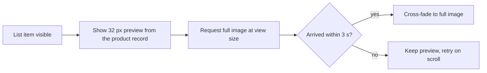

| Status | Accepted |
| -- | -- |
| Created | 2026-03-04 |
| Authors | DemoKen |
| Reviewers | DemoOscar, DemoMike |
| Target | App 5.16, Q3 2026 |
| Decision | [ADR-041 Serve images from a CDN with on-the-fly resizing](@ADR-041) |

## Summary

Ask the image CDN for AVIF on devices that decode it quickly, WebP everywhere else, and JPEG only as a last fallback. Request each image at the exact pixel size of its view, and show a 32-pixel blurred preview until the full image arrives.

## Motivation

* Images are 78 % of the bytes the app downloads. A median browsing session loads 42 product images, 9.6 MB as JPEG ([RN-064](@RN-064)).
* On mobile networks in our largest markets a product list takes a median of 2.3 seconds until every visible image is shown.
* The CDN already converts and resizes on request ([ADR-041](@ADR-041)), but the app always asks for the 1,200-pixel JPEG and scales it down on the device.

## Proposal

### Format by device

| Device | Format | Why |
| -- | -- | -- |
| iOS 16 and later | AVIF | Hardware decoding; 4.1 MB per session |
| Recent and mid-range Android | AVIF | Decode under 15 ms per image |
| Low-end Android | WebP | AVIF decodes in 38 ms per image there and drops frames while scrolling |
| Anything else | JPEG | Fallback |

The app sends the format in the `Accept` header; the CDN picks the first it can produce.

```kotlin
val accept = when {
    deviceClass == DeviceClass.LOW_END -> "image/webp,image/jpeg"
    else -> "image/avif,image/webp,image/jpeg"
}
```

### Exact sizes

The app asks for the view's size in pixels, rounded up to a step of 80 so the CDN cache stays small:

```text
https://img.example.com/p/8c1f2a/main?w=480&h=480&fit=cover
```

### Progressive display



The 32-pixel preview is a base64 WebP of about 600 bytes, added to the product record in search and catalog responses.

## Alternatives

| Option | Data per session | Decode cost | Why not |
| -- | -- | -- | -- |
| JPEG at 1,200 px (today) | 9.6 MB | low | Slow on mobile networks |
| WebP everywhere | 6.4 MB | low | Leaves a third of the saving unused |
| AVIF everywhere | 4.1 MB | high on low-end Android | Janky scrolling |
| **AVIF or WebP by device, exact sizes** | **about 4.5 MB** | **low** | Chosen |

## Rollout

- [X] Device classes in the app ([SPEC-076](@SPEC-076))
- [ ] Exact sizes in product lists and the product page
- [ ] AVIF and WebP by device behind the `image_formats` flag
- [ ] Preview images in catalog responses ([SPEC-036](@SPEC-036))
- [ ] Measure data per session and scroll smoothness again

## Open questions

* Should the web shop use the same rules? It already negotiates formats in the browser; only exact sizes are missing there.
