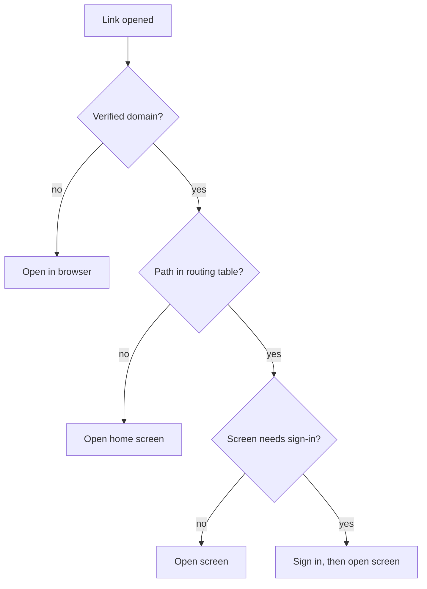

| Status | Implemented |
| -- | -- |
| Created | 2025-11-25 |
| Authors | DemoJudy |
| Reviewers | DemoNina, DemoLaura |
| Target | App 5.1, Q1 2026 |
| Decision | [ADR-024 Build the mobile app natively in Kotlin and Swift](@ADR-024) |

## Summary

Make every product, category, search, order and campaign page open directly in the app from a web link, a push notification or an email, using the same paths as the web shop. One routing table, shared by both apps, maps paths to screens.

## Motivation

* Only product pages open in the app today. Links to orders, searches and campaigns open the web shop, even when the app is installed.
* Order emails are opened on a phone 74 % of the time; buyers then sign in again on the web to see their order.
* Push notifications build their own `demomart://` links by hand, and three of them pointed to screens that no longer exist after the 2025 redesign.

## Proposal

### One path space

Web and app use the same paths. A universal link (iOS) or app link (Android) for `https://www.example.com/...` opens the app when it is installed and the web shop otherwise. The custom scheme `demomart://` stays for push notifications only.

| Path | Screen | Example |
| -- | -- | -- |
| `/p/{productId}` | Product | `https://www.example.com/p/8c1f2a` |
| `/c/{categorySlug}` | Category | `https://www.example.com/c/garden` |
| `/search?q={query}` | Search results | `https://www.example.com/search?q=lamp` |
| `/orders/{orderId}` | Order detail | `https://www.example.com/orders/o_7731` |
| `/campaign/{slug}` | Campaign | `https://www.example.com/campaign/spring` |

The full table is [SPEC-071](@SPEC-071).

### Routing



Both apps generate their routers from one file:

```json
{
  "routes": [
    { "path": "/p/{productId}", "screen": "product", "auth": false },
    { "path": "/orders/{orderId}", "screen": "order_detail", "auth": true },
    { "path": "/campaign/{slug}", "screen": "campaign", "auth": false }
  ]
}
```

### Domain verification

The web shop serves `apple-app-site-association` and `assetlinks.json` for `www.example.com`. Paths under `/account/password` and `/help` are excluded and always open in the browser.

## Alternatives

| Option | One link for web and app | Why not |
| -- | -- | -- |
| Custom scheme everywhere | no | Fails without the app; email clients block it |
| A link shortener that redirects | yes | Extra hop, third party sees every link |
| **Universal and app links on the web paths** | **yes** | Chosen |

## Rollout

- [X] Shared routing file and generated routers
- [X] Domain association files on the web shop
- [X] Order emails link to `/orders/{orderId}` ([SPEC-055](@SPEC-055))
- [X] Push notifications use routes from the table ([SPEC-070](@SPEC-070))
- [X] Remove hand-built links from all senders

## Open questions

* Deferred deep links (open the right screen after a fresh install)? Not in this RFC; it needs an attribution decision first.
