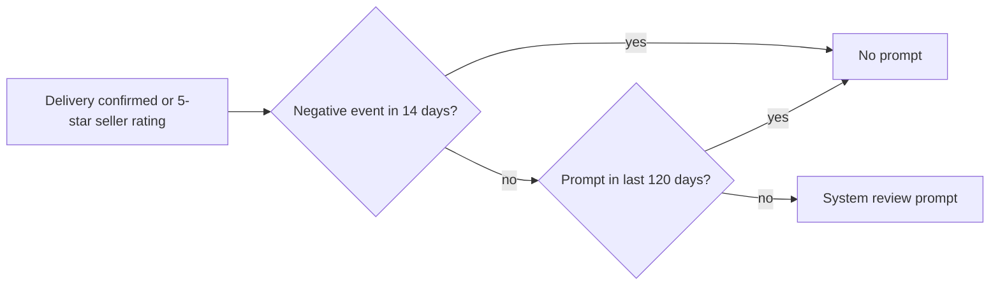

| Status | In review |
| -- | -- |
| Created | 2026-09-22 |
| Authors | DemoLaura |
| Reviewers | DemoJudy, DemoPeggy |
| Target | App 5.21, Q4 2026 |
| Evidence | [RN-069 Review prompt timing experiment](@RN-069) |

## Summary

Ask buyers to rate the app in the store only after a moment that went well: a delivery they confirmed, or a 5-star rating they gave a seller. Never after a refund, a failed payment or a support contact, and at most once every 120 days.

## Motivation

* The app's store rating is 4.1 on iOS and 3.9 on Android. 62 % of written reviews in 2026 mention a problem with one order.
* The app asks on the third app open today. In [RN-069](@RN-069) only 4.2 % of those prompts on iOS and 5.1 % on Android led to a rating, against 14.6 % and 16.2 % after a 5-star seller rating.
* Both stores limit how often the system prompt can appear (three times a year on iOS), so each prompt should count.

## Proposal

### Triggers

| Trigger | Ask | Reason |
| -- | -- | -- |
| Buyer confirms a delivery | yes | Highest share of ratings among neutral moments |
| Buyer rates a seller 5 stars | yes | Highest share of ratings overall |
| Third app open | no | Low share of ratings |
| Refund, failed payment, support chat in the last 14 days | never | Ratings drop to 2.1 to 2.6 % and skew negative |

### Rules in code

```kotlin
fun shouldAskForReview(state: ReviewState, event: AppEvent): Boolean {
    if (event !is AppEvent.DeliveryConfirmed && event !is AppEvent.SellerRated) return false
    if (event is AppEvent.SellerRated && event.stars < 5) return false
    if (state.lastPromptAt?.isAfter(now().minusDays(120)) == true) return false
    if (state.lastNegativeEventAt?.isAfter(now().minusDays(14)) == true) return false
    return true
}
```

The prompt itself is the system dialog (`SKStoreReviewController` on iOS, the Play in-app review API on Android). The app does not ask "Do you like DemoMart?" first, because both stores' guidelines discourage filtering prompts by a pre-question.



## Alternatives

| Option | Ratings per prompt | Why not |
| -- | -- | -- |
| Third app open (today) | 4 to 5 % | Wastes the yearly limit |
| Pre-question, then prompt only for happy buyers | not measured | Against store guidelines |
| **Positive moments only** | **12 to 16 %** | Proposed |

## Rollout

- [ ] Review of this RFC
- [ ] Triggers behind the `review_prompt_v2` flag ([ADR-022](@ADR-022))
- [ ] Analytics events for prompt shown and rating submitted ([SPEC-073](@SPEC-073))
- [ ] Compare store rating trend after 8 weeks

## Open questions

* Should sellers' Seller Hub app follow the same rules? Out of scope here.
* Is 120 days right on Android, where the store sets no fixed yearly cap? Proposed for both to keep one rule.
