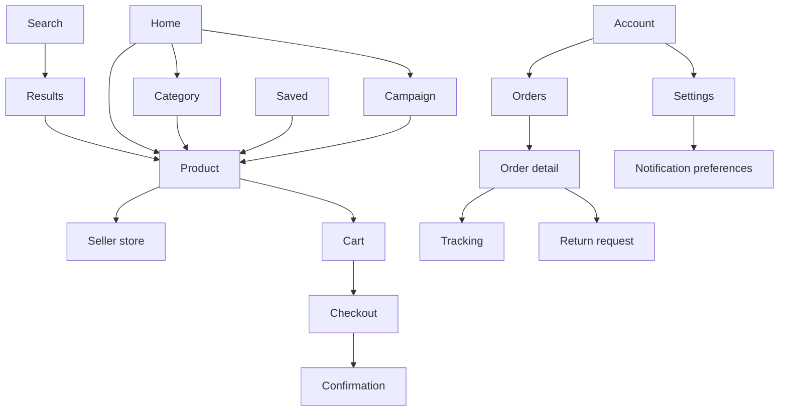

| Status | Stable |
| -- | -- |
| Version | 2.1 |
| Updated | 2026-04-20 |
| Owner | DemoJudy |
| Applies to | The DemoMart app for iOS and Android, from app 5.0 |

## Overview

The app has five tabs. Each tab keeps its own back stack, so switching tabs never loses the buyer's place. Every screen has a route ([SPEC-071](@SPEC-071)) and can be opened by a deep link; screens that need an account ask for sign-in first and continue afterwards.

## Tabs

| Tab | Root screen | Needs sign-in | Badge |
| -- | -- | -- | -- |
| Home | Server-driven home ([SPEC-072](@SPEC-072)) | no | none |
| Search | Search with suggestions | no | none |
| Saved | Saved products and price alerts | yes | price drops since last visit |
| Cart | Cart ([SPEC-046](@SPEC-046)) | no | number of items |
| Account | Orders, addresses, settings | yes | orders with news |

## Screen map

## Rules

1. **Back.** The system back gesture and the back button go back within the current tab's stack. At a tab's root, Android's back moves to the Home tab, then leaves the app.
2. **Reselecting a tab** scrolls its root to the top; reselecting again pops the stack to the root.
3. **Checkout** opens as a full-screen flow over the tabs ([SPEC-045](@SPEC-045)). Closing it returns to the cart.
4. **Deep links** open the target screen on top of the matching tab's root, so back always leads somewhere sensible: a product link opens on the Home tab, an order link on the Account tab.
5. **Sign-in** opens as a sheet; after success the requested screen opens, after cancel the previous screen stays.

## Screen ids

Analytics events name screens by these ids ([SPEC-073](@SPEC-073)):

| Screen | Id | Tab |
| -- | -- | -- |
| Home | `home` | Home |
| Search results | `search_results` | Search |
| Category | `category` | Home |
| Product | `product` | Home or Search |
| Seller store | `seller_store` | Home |
| Cart | `cart` | Cart |
| Checkout | `checkout` | over all tabs |
| Order detail | `order_detail` | Account |
| Notification preferences | `notification_prefs` | Account |

## Version history

| Version | Date | Change |
| -- | -- | -- |
| 1.0 | 2025-06-02 | Four tabs, shared back stack |
| 2.0 | 2026-01-13 | Five tabs with a Saved tab, one back stack per tab |
| 2.1 | 2026-04-20 | Rule 4: deep links open over the matching tab's root |

## Related

* [RFC-071 Deep links for every product and order](@RFC-071)
* [SPEC-077 Accessibility requirements for the app](@SPEC-077)
